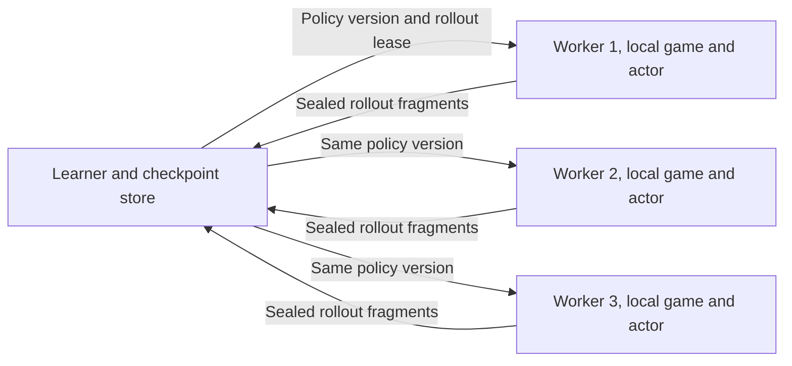

# Distributed native rollouts

The first scaling target is more verified original-game decisions per second. The Windows TH14 1.00b run spent 267.8 of 291.4 seconds in native stepping for an additional 4,096 decisions, about 14.1 accepted decisions per second end to end. Four native frames per decision at a 60 Hz game clock give a nominal ceiling of 15 decisions per second per real-time instance. The Linux and SteamOS pilot runs ZUN's actual TH14 0.01b trial, with a separate benchmark from the Steam training task. [Windows PPO timing](../results/2026-11-23-th14-full-policy/survival-8192-train.json)

## Native scaling measurements

Each Linux trial worker runs its own Wine process with a private display and null audio sink. The benchmark reads player position, stage frames, lives and the linked projectile list directly from the game. All configurations use 128 decisions per short opening episode. Rates include in-run Retry and SSH request/response time. The measurement starts after all instances are ready.

| TH14 0.01b configuration | Decisions / s | Exact four-tick decisions | Verified Retry calls |
| --- | ---: | ---: | ---: |
| Deck, Entropy and Accelerator, equal budgets | 21.38 | 768/768 | 3 |
| Same hosts, Accelerator twice, weighted budgets | 56.60 | 2,047/2,048 | 12 |
| Four instances on Accelerator | 60.11 | 2,048/2,048 | 12 |
| Eight instances on Accelerator | 86.53 | 4,096/4,096 | 24 |
| Four instances on Gamer in Ubuntu WSL2 | 65.89 | 1,536/1,536 | 12 |
| Four instances on Entropy with native-tick menu input | 26.62 | 1,536/1,536 | 8 |

In the equal-budget run, individual worker rates were 7.13 for Deck, 13.81 for Entropy and 20.07 for Accelerator. Fixed equal quotas left the faster workers idle while Deck finished. The mixed four-worker run used two episodes on Deck, four on Entropy and five per Accelerator instance. It changed both the quota distribution and the instance count. The one non-nominal transition on Entropy advanced five ticks. All workers responded to left/right inputs and exposed original projectiles. Doubling the Accelerator pool from four to eight raised aggregate throughput by 44% and reduced each instance's rate from approximately 15 to 11 decisions/s. These are early-stage rollout probes. Measure denser patterns and longer runs before choosing the production instance count. [Equal quotas](../results/2026-11-23-distributed-rollouts/th14-three-workers.json), [Weighted mixed pool](../results/2026-11-23-distributed-rollouts/th14-four-mixed.json), [Four instances](../results/2026-11-23-distributed-rollouts/th14-four-accelerator.json), [Eight instances](../results/2026-11-23-distributed-rollouts/th14-eight-accelerator.json)

Gamer's four-way WSL2 benchmark used 96 decisions per episode to match its single-worker control. Throughput rose from 18.23 to 65.89 decisions/s, a 3.61× speedup. Each WSL container had its own Wine prefix, display and input, leaving the Windows desktop separate. Entropy ran four containers with two CPUs each. Fixed-wall-time menu taps failed to start all four under contention. Holding inputs for native ticks and waiting for the native stage clock cut that dependency and recovered all four. [Gamer one](../results/2026-11-23-distributed-rollouts/th14-one-gamer.json), [Gamer four](../results/2026-11-23-distributed-rollouts/th14-four-gamer.json), [Entropy four](../results/2026-11-23-distributed-rollouts/th14-four-entropy.json)

On Steam Deck, changing the offscreen graphics path from Xvfb with software WineD3D to hardware DXVK with headless Gamescope and a separate rootful Xwayland raised throughput from 6.76 to 11.96 decisions/s. Both variants produced 256 exact four-tick decisions and passed movement and Retry checks. Median step latency fell from 128.71 to 81.55 ms. The embedded rootless Xwayland variant could not keep a valid game swapchain. This is a short renderer and display comparison on the trial. [Deck renderer benchmark](../results/2026-11-23-distributed-rollouts/th14-deck-renderer-ab.json)

On Windows TH14 1.00b FAST mode, a reversible limiter-only experiment measured a median of 60.03 versus 120.10 native stage ticks/s and Retry medians of 1.252 versus 0.626 seconds. Both rates produced 192/192 exact four-tick decisions in the first probe. A second probe aligned both caps at stage frame 30 and yielded 384/384 exact four-tick decisions. The two 120 Hz repetitions ran at 117.54 and 59.69 ticks/s. Projectile traces differed even between repeated runs at stock 60 Hz. Keep the stock runtime as the official evaluation reference and treat 120 Hz as a candidate that needs reproducible replay and sustained-speed validation. [Timing summary](../results/2026-11-23-distributed-rollouts/th14-windows-clock-summary.json), [Aligned comparison](../results/2026-11-23-distributed-rollouts/th14-windows-clock-aligned.json)

The Windows probe reads the active limiter. The 120 Hz wrapper applies the setting temporarily to the verified Steam executable in Fast input mode and restores its original limiter afterward. Start Normal Reimu A Stage 1 before comparing the two caps.

```powershell
python -m scripts.benchmark_native_clock --parakit ../parakit --label stock-60 --start-frame 30 --steps 96 --repeats 2 --out runs/clock-60.json
python -m scripts.benchmark_native_clock_120 --parakit ../parakit --label candidate-120 --start-frame 30 --steps 96 --repeats 2 --out runs/clock-120.json
```

## Qualify each game runtime

Give each worker its own original-game process, display and input focus, writable game state, and reset lifecycle. On Linux use a separate Wine or Proton prefix and virtual display per instance, with game assets mounted read-only where possible. The Windows runner needs an exclusive interactive session, desktop or guest that passes the same input tests. Keep one worker per host initially. Use a second instance on a host only after measuring how rendering, pause/resume and reset change under contention.

The Win32 fixture exercises DirectInput, Direct3D 9, debugger attach and cross-process reads. The official trial exercises original-game load and isolated input. Training comparisons for the full game require the Steam 1.00b executable, its matching memory offsets and the same observation, action, event and reward schema as the Windows runner. Treat any trial or full-build mismatch as a separate environment identifier. [Worker probes](../results/2026-11-23-th14-full-policy/worker-probes.json)

Before admitting a worker to the rollout pool, record the executable and offset hashes, OS/runtime and renderer, task, action repeat, observation schema, reward version and exact launch revision. Run a fixed action trace and check native frame deltas, movement in both directions, parsed bullets and resources, one life-loss event, 20 consecutive Retry cycles, and 30 minutes of unattended input isolation. Compare the trace with the reference where the start state and RNG are controlled. Log the observed start state and clock when Retry does not give a deterministic replay seed. The initial gate is at least 99% four-frame deltas on the hold test. Preserve the complete histogram. Use central playfield positions for input checks because valid input can produce zero displacement at an edge.

## Actor and learner



1. The learner publishes an immutable actor-critic snapshot. Identify it by policy version and hash. Include observation transforms and their frozen statistics, action ordering, action sampler, reward and discount configuration. Each worker loads it and acknowledges the hash and environment signature before receiving a lease.
2. Each worker owns inference and step execution. While the game is paused, read a consistent observation, sample movement, focus, shoot and bomb, apply input, advance four nominal native ticks, pause again and read the next observation. Store the sampled action, the joint log-probability across its heads, value estimate, observed reward event and terminal flags under the same snapshot. Carry temporal observation history across adjacent steps and reset it at an actual game reset.
3. Keep the snapshot fixed for every fragment. Start with 256 valid decisions per worker to match the existing single-instance PPO rollout length. The worker collects across game episode boundaries as needed and seals fragments with their bootstrap observations. At a round boundary it can pause a live game, then resume that episode under the next acknowledged snapshot. Each fragment retains only one behavior version. Keeping the episode alive lets longer trajectories reach later attack patterns.
4. The learner accepts a complete same-version batch, computes GAE within each contiguous path, normalizes advantages over accepted decisions, then runs PPO. With three workers and 256 decisions each, the batch is 768 decisions. Reward and behavior log-probabilities are already recorded, so the update can measure the ratio to the actual sampling distribution. Compare the same rollout batch size, optimizer passes and total accepted interaction budget when isolating the effect of parallelism. [PPO](https://arxiv.org/abs/1707.06347), [GAE](https://arxiv.org/abs/1506.02438)
5. After the update and its manifest are durable, publish the next snapshot and open the next round. Start with this synchronous barrier. Measure barrier wait by worker before tuning leases or moving to asynchronous learning. If stale-policy trajectories are explicitly allowed in a later design, use a separately specified off-policy correction and log behavior version lag. [IMPALA and V-trace](https://proceedings.mlr.press/v80/espeholt18a.html)

The first-miss Stage 1 pilot treats a first miss, stage clear and its defined survival horizon as task terminals. Bootstrap those transitions at zero. At an external time limit where the task would continue, bootstrap from the final pre-reset observation and stop the GAE recursion at the trajectory boundary. Also bootstrap the last value of a live fragment at a round boundary using that fragment's snapshot. A crash, focus loss or unobservable transition is an infrastructure failure. Keep the last valid observation for any retained prefix and record the failed step separately. [Current reward and termination implementation](../scripts/train_full_policy.py), [Gymnasium time limits](https://gymnasium.farama.org/tutorials/gymnasium_basics/handling_time_limits/)

## Wire format and recovery

For the native transport probe, one SSH process per host can carry structured step commands and responses over its standard streams. This measures the original-game boundary and the cost of a remotely driven loop. For training, move per-step inference to the host and send a sealed binary fragment per lease, including its boundary observations. Reuse one authenticated connection and bound the unacknowledged queue by decisions or bytes. A host with multiple qualified games can batch their policy inference. Consider centralized batched inference later if the actor grows substantially and measured network latency leaves enough of the roughly 67 ms decision interval. [SEED RL](https://openreview.net/forum?id=rkgvXlrKwH), [Sample Factory](https://proceedings.mlr.press/v119/petrenko20a.html)

Use contiguous observation arrays containing the normalized context and a padded projectile tensor. Send the projectile mask or count and all basis fields needed to reconstruct the observation exactly. The projectile tensor alone is 2,688 bytes per step at 96 × 7 float32 values. At three real-time workers its raw bandwidth is about 121 KB/s before extra fields and framing. Measure encoding, bytes and latency first. A small binary batch removes per-step serialization overhead and makes command round trips unnecessary for training. Keep screenshots and native recordings as sampled diagnostics.

A fragment header needs the run ID, policy hash, environment signature, worker and lease IDs, fragment sequence and checksum. Keep the game episode and decision index, global and stage clocks, actual frame delta, action, old log-probability and value, reward event, termination and truncation flags, and final observation in the body. Send one schema version per run and validate shapes, finite values and continuity before acceptance. The protocol defines which small frame deviations are admissible for that run. Keep their actual deltas and reject desynchronized transitions. A reset marks a new episode even if it happens inside one lease.

Persist sealed fragments long enough to tolerate lost acknowledgments, and deduplicate resends by run, policy version, lease and fragment sequence. When a lease expires, invalidate it before granting that quota elsewhere. Restart uncertain game state at a recorded task boundary. A timed-out step can have reached the game, so a reconnect starts a new clean episode instead of retrying that input. Limit each worker to one active lease initially. Record attempted, accepted, rejected and duplicate decisions separately. Store optimizer state, policy and normalizer state, seeds, counters and the accepted fragment IDs together at each committed learner update so a restart can identify which data it consumed.

## Scale with measurements

Run one worker per machine separately, then the same machines concurrently using the same task and trace. Report cold startup time, accepted decisions per active collection second and per wall-clock second, native frame delta distribution, input failures, reset latency and success, memory read time, inference time, transport bytes and round trips, CPU and memory use, and learner and barrier time. Use monotonic clocks for worker-local durations and coordinator wall time for the concurrent run. Include at least median and p95 step/reset latency and publish the number of measured decisions. Measure concurrency scaling against the sum of each worker's solo rate as well as the matched single-worker baseline. A three-worker ceiling of 45 decisions per second is a hardware planning estimate from the nominal clock. The measured end-to-end rate must include reset, validation and straggler overhead.

Tune in this order. First make the clock, reset and input paths reliable. Next remove avoidable per-action waiting, combine memory reads where the layout permits, and move inference to the worker. Then increase the number of workers and profile the learner. Evaluation uses independent workers or runs between training rounds to keep its time out of rollout throughput. Higher execution speed requires a separate native-timing parity test before accelerated rollouts can count toward the original-game experiment.

## Speed up the game runtime

| Change | What it changes | First test |
| --- | --- | --- |
| Omit screenshots from stepping | Removes frame capture and encoding. The existing memory-observation loop already reads game state without screenshots. | Keep screenshots for launch failures and sampled diagnostics. Benchmark with the same policy and four-tick step. |
| Give each game a virtual display | Xvfb removes the physical screen and preserves an isolated window for input. The game still draws through Direct3D under Wine. | Run one, two and then four isolated instances per host if resource headroom allows. Record aggregate native ticks and accepted decisions per second. [Xvfb documentation](https://manpages.debian.org/bookworm/xvfb/Xvfb.1.en.html) |
| Send audio to a null sink | PulseAudio drops samples while exposing a clocked sink. The worker launchers retain an audio endpoint after the trial stalled on Wine without one. | Keep one null sink per instance. Test a truly audio-disabled variant independently and verify loading, stage progression and Retry before using it. [Trial launcher](../tools/rollout-worker-probe/run-th14-trial.sh), [PulseAudio null sink](https://wiki.freedesktop.org/Software/PulseAudio/Documentation/User/Modules/#module-null-sink) |
| Reduce rendering or presentation cost | WineD3D software rendering and GPU-backed DXVK are different renderer paths. DXVK translates D3D9 to Vulkan and its `d3d9.presentInterval = 0` can remove presentation VSync. Draw work and the game's own limiter still apply. A render-skip or presentation bypass is a separate experimental variant. | Keep 640×480 and native stepping fixed. Compare software WineD3D with DXVK on a host that exposes a working Vulkan device and compatible display backend. Measure host CPU/GPU use and step latency at equal clocks before changing any simulation setting. [DXVK](https://github.com/doitsujin/dxvk), [DXVK configuration](https://github.com/doitsujin/dxvk/blob/master/dxvk.conf) |
| Hold each action for more native ticks | Changes the control frequency and samples fewer decisions from the same amount of simulated time. | Keep four ticks for the acceleration comparison. Treat longer action repeat as a separate policy ablation with its own discount and observation history. |

The first fast-forward candidate is a windowed TH14 1.00b timing run at 60, 90 and 120 FPS. The `thprac` v2.3.1.1 TH14 **Game Speed** control in **Advanced Options** (`F12`) changes the live pacing interval to `1 / fps` when the game's `custom.exe` input latency is set to **Fast**. Its other paths use a recognized `vpatch_th14.dll` with VSync disabled or OpenInputLagPatch. The same `thprac` UI offers 90 and 120 FPS presets. Replay playback speed has separate control logic. [TH14 implementation](https://github.com/touhouworldcup/thprac/blob/55e6ed1336621e3099e7df1138acc360cf0500fa/thprac/src/thprac/thprac_th14.cpp#L926-L978), [FPS presets](https://github.com/touhouworldcup/thprac/blob/55e6ed1336621e3099e7df1138acc360cf0500fa/thprac/src/thprac/thprac_games.cpp#L514-L555), [Advanced Options](https://github.com/touhouworldcup/thprac/tree/v2.3.1.1#advanced-options)

For unattended runs, the OpenInputLagPatch source accepts the exact Steam 1.00b executable hash recorded in the Windows pilot. It replaces the game's frame limiter and selects the Fast input path. Set `GameFPS` in the patch's `[Option]` configuration and keep its replay-speed controls disabled for the initial test. Run stock 60 first, then patched 60 to isolate changes from loading the patch itself, then patched 90 and 120 one at a time. The source establishes a supported configuration. Effective native tick rate and game-state equivalence still require measurement on our runner. [Supported executable hashes](https://github.com/khang06/OpenInputLagPatch/blob/e4eb70ba0b95a4af9994dbc746cebce8d3b7eb0f/openinputlagpatch/games_def.h#L101-L106), [TH14 limiter hook](https://github.com/khang06/OpenInputLagPatch/blob/e4eb70ba0b95a4af9994dbc746cebce8d3b7eb0f/openinputlagpatch/games/touhou14.cpp#L13-L47), [Patch configuration](https://github.com/khang06/OpenInputLagPatch/blob/e4eb70ba0b95a4af9994dbc746cebce8d3b7eb0f/README.md#configuration)

1. Hold executable, host, difficulty, shot, assets and renderer constant. Replay the same known-good file under each variant. Compare input and replay cursors, stage and global clocks, player position, projectile state, and ordered miss, bomb, score and stage events at matched native ticks. Use stable projectile ordering and record the first divergence with its full state. Validate patched 60 against stock 60 before interpreting the faster points.
2. Run the live worker with identical scripted four-tick actions from a matched state where available. Include both movement directions, focus, shooting, a bomb edge, dense bullets, a life-loss boundary and 20 Retry cycles. Apply the four-tick fidelity gate above and account for every non-nominal or rejected step. Fix the start-state and RNG evidence in the report when the game cannot reset deterministically.
3. Measure native stage ticks per monotonic wall second and accepted decisions per wall second. Collect at least 1,024 decisions per variant after warmup and include resets in end-to-end timing. A true 120-native-tick rate at four ticks per decision has a 30-decisions/s ceiling. A visible FPS counter alone cannot establish that the game progresses at that rate.
4. Retain a variant for training only when it improves accepted throughput and passes the replay, input and reset checks. Repeat at concurrent worker counts before choosing between more native instances and faster instances. Keep the unmodified real-time build as the evaluation reference.

## One shared PPO policy versus independent models

Run both arms from the same initialized actor-critic checkpoint. For the shared learner, each worker samples the same version and contributes to one PPO update. For the weight-averaging arm, train three independent copies with distinct rollout seeds, equal interaction budgets and the same task distribution. Give the shared learner the same total number of accepted native decisions as the three branches combined. Record the number of optimizer updates, minibatches and wall-clock seconds separately to make compute differences visible. Evaluate the common initial checkpoint, all three branches, the equal-weight parameter average and the shared-policy endpoint on the same frozen evaluation manifest.

Average floating-point parameter tensors in FP32 after checking checkpoint lineage, tensor keys, shapes and action and observation semantics. Keep any non-floating state identical, keep the same observation transform for the experiment, and initialize a fresh optimizer if the merged policy resumes training. Report the three branch scores alongside the merge, as averaging can reduce a strong branch's performance. If helpful later, add a policy ensemble as a separate control with the same evaluation budget. Iterative FedAvg broadcasts a new average before each round of independent updates. The first pilot uses one merge after independent training. [Model Soups](https://proceedings.mlr.press/v162/wortsman22a.html), [FedAvg](https://proceedings.mlr.press/v54/mcmahan17a.html), [WARP](https://arxiv.org/abs/2406.16768)

For original TH14, keep difficulty, shot, stage, reward, action decoding and controller overrides fixed during the comparison. Report stage clears, first miss, score, bomb use and move frequency over multiple seeds. Record which runs used only learned actions. An external benchmark such as CartPole can first validate transport, policy lineage and merging. Its scores measure that test task and its runtime rather than Touhou performance.

### CartPole transport and merge control

The three branches shared a 1,024-step parent and collected 4,096 additional decisions each. Shared PPO and serial PPO each used 12,288 additional decisions. The mean returns below come from the same 20 evaluation seeds with one training seed per arm.

| Arm | Mean return |
| --- | ---: |
| Common parent | 91.50 |
| Steam Deck branch | 89.35 |
| Entropy branch | 225.95 |
| Accelerator branch | 141.35 |
| Equal-weight merge | 176.10 |
| Shared PPO over three hosts | 341.15 |
| Serial PPO | 422.90 |

Training the three independent branches and returning their weights took 9.37 seconds elapsed. Shared PPO with remotely driven environments collected at 96.16 decisions/s over 127.78 seconds after 3.54 seconds of startup. Local serial PPO collected approximately 2,730 decisions/s over 4.50 seconds. That gap measures the round-trip cost on a cheap test environment and motivates hosting inference beside native games. Shared PPO collected 384 decisions per update and serial PPO collected 128, so the learning scores also reflect different update schedules. The merge exceeded two branches and finished below the strongest branch in this run.

Transferring an SB3 archive across the Windows NumPy 1 and Linux NumPy 2 environments failed to deserialize. The pilot transferred tensor weights only and reconstructed the model on each side, which also kept optimizer state local to each branch. [CartPole benchmark and raw returns](../results/2026-11-23-distributed-rollouts/cartpole-weight-merge.json)

[Paper and resource list](resources.md)
