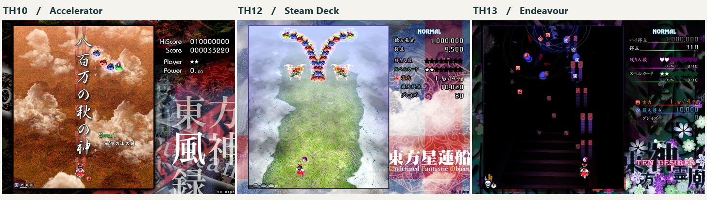
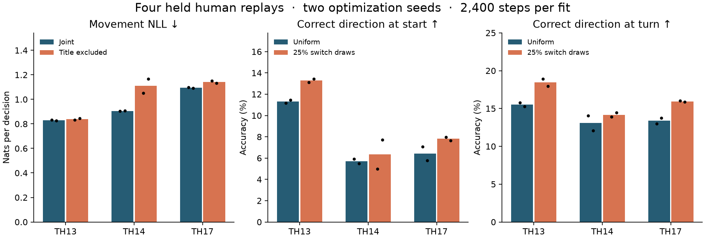

# Multi-title original-game rollout and policy transfer

Each panel is a crop of a separately captured original client. All three clients reached Normal Stage 1. The three captures were taken at different times. The TH14 Windows full-credit queue runs independently.

| Host | Original game and work completed | Measurement |
| --- | --- | --- |
| Accelerator | TH10 official trial 0.02a, one additional isolated client | 581 native reads in 14.487 s. A right command moved X from 0 to 99. Left moved X to −67.5. The raw score counter rose to 3,322 and the HUD displayed 33,220. |
| Endeavour | TH13 official trial 0.01a, two simultaneous clients | 16 fresh bounded validation credits. Of 48 horizontal input blocks, 32 had a visible player at both endpoints and all 32 moved in the requested direction. The subsequent pixel cohort contains 24 separate credits and 1,920 transitions. |
| Steam Deck | TH12 official trial 0.02a, two private clients | Both entered Stage 1. In the first measured left command on Alpha, screen X changed from approximately 227 to 178. |
| Accelerator, Entropy, Momentum | TH14 official trial 0.01b, two clients per host | Each produced 6,800 accepted training windows. The sealed total is 20,400 windows, 893 injuries and 180,694 checked decisions. Each host also ran 12 pairs of closed-loop first-injury trials. |
| Momentum | RTX 5090 learner | Eight fixed-budget SFT fits and two direction-change sampling fits on original TH13, TH14 and TH17 replay states. |

TH10 has native position and stock measurements. TH12 and TH13 use private-display pixels and measured wall time here. Client restarts, episode counts and controller time stamps are recorded separately from native ticks. Completing a bounded opening with spare lives is insufficient evidence for a stage clear.

[TH10 native movement and score](th10-native-response.json) · [TH10 observations](th10-native.csv) · [TH10 input timestamps](th10-inputs.csv) · [Two TH13 clients](th13-two-instances.jpg) · [TH13 opening trials](th13-opening-inputs.json) · [TH13 episode hashes](../2026-11-25-multititle/th13-endeavour-original-trial.json) · [TH14 training cohort](../2026-11-25-th14-native-policy/train-only-trial-held12-corpus.json)

## Closed-loop TH14 result

Six original-game workers completed 72 fresh credits in a fixed 36-pair comparison. The endpoint is the first observed injury by native frame 1,700 in the trial's first stage. One arm sampled actions uniformly. The other repeatedly sampled among the four lowest predicted movement risks under the assigned focus. Injuries occurred in 35/36 uniform credits and 17/36 model-assisted credits. The paired risk reduction was 50 percentage points with a 95% host-stratified bootstrap interval of 33–67 points. Restricted mean survival rose from 826.1 to 1,419.2 native frames. All three physical hosts had a positive estimated difference. This result covers the TH14 opening and the two tested controllers. [Fixed trial assignments](th14-randomized-plan.json) · [Results by physical host](th14-closed-loop-outcomes.json) · [Untouched intervention cohort](th14-contact-held-episodes.json)

## Replay transfer and movement starts

Each arm trained from random initialization for 2,400 optimizer steps of 256 samples each. Titles were equally likely, with uniform samples within title in the primary comparison. The training pool contained 26,262 TH13, 89,645 TH14 and 100,443 TH17 original state/action records. The four held replays contribute 94,432 decisions. The fits excluded their players and checked for duplicate shard digests. The evaluation has one TH13 player, one TH14 player and two TH17 replays, so player diversity remains a limitation. TH15, TH18 and TH19 stayed outside this experiment.

| Evaluated title | Joint movement NLL | NLL training without that title | Exact direction on movement starts, uniform → switch sampling | Exact direction on turns, uniform → switch sampling |
| --- | ---: | ---: | ---: | ---: |
| TH13 | 0.830 | 0.838 | 11.33% → 13.28% | 15.53% → 18.45% |
| TH14 | 0.906 | 1.111 | 5.72% → 6.34% | 13.08% → 14.17% |
| TH17 | 1.096 | 1.142 | 6.42% → 7.82% | 13.37% → 15.95% |

Values average two optimization seeds. The transfer comparison holds total training draws fixed. The direction-change experiment replaces 25% of uniform draws with recorded action changes using training labels only. It was a follow-up after inspecting the uniform fit on these same four diagnostic replays. Start and turn accuracy rose on all three titles, while overall movement NLL worsened on all three. Frozen policies still need independent closed-loop evaluation. Frame counts alone cannot establish between-player or between-game uncertainty.

[Training logs and split fingerprints](transfer-matrix-live.json) · [Direction-change counts and previous-action baseline](switches.json) · [Switch-sampled fits](switch-training25.json) · [Switch-sampled evaluation](switches25.json)

## A common observation stream on three games

The first shared pixel cohort contains 53 fresh original-game credits and 4,000 executed transitions. TH10 supplied 5 × 32, TH12 supplied 24 × 80, and TH13 supplied 24 × 80. The fixed split contains 35 training, 9 development, and 9 test credits. The two Steam Deck lanes captured gameplay simultaneously for 58.32 seconds. The movie displays a training credit from each title at its measured elapsed time and overlays its logged action. [Three original rollout traces on video](three-original-rollouts.mp4) · [Three-title source hashes](three-title-episodes.json) · [TH10 episodes](th10-accelerator-episodes.json) · [TH12 episodes](th12-deck-episodes.json)

On the nine held credits, a one-step predictor conditioned only on elapsed time, title and current image beat frame copying on all three titles. Adding the executed controls failed to improve whole-image prediction. A second diagnostic trained to infer the horizontal key from the current and successor images was only slightly more accurate than using the current image alone. This limits the case for using these full-image dynamics losses to steer a player.

| Held game | Mean pixel MSE, copy | Time and title model | With action | Horizontal input decoded, current → image pair |
| --- | ---: | ---: | ---: | ---: |
| TH10, 1 credit | .013019 | .004563 | .004654 | 8/32 → 13/32 |
| TH12, 4 credits | .004778 | .002435 | .002474 | 104/320 → 108/320 |
| TH13, 4 credits | .002755 | .002351 | .002378 | 112/320 → 118/320 |

Four further TH13 credits from Entropy used the frozen policies and new controller seeds. Current-image versus paired-image decoding there was 116/320 versus 124/320. These were separate episodes on a second physical host. [Fixed protocol](pixel-protocol.json) · [Dynamics and shuffled-action scores](pixel-dynamics.json) · [Input-decoding confusion matrices](pixel-controls.json) · [External host results](th13-frozen-entropy.json)

The reward adapters were exercised separately. Four TH12 credits had two confirmed stored-life drops each, and remained playable at the 60-second time limit with zero spares. A TH13 credit displayed an active death trance at the boundary, so the collector also saves follow-up frames to distinguish an imminent loss from a settled one. [TH12 stock-drop timings](th12-first-stock-loss.json) · [TH13 60-second crossed controls](../2026-11-25-multititle/th13-60s-resource-probe.json)
