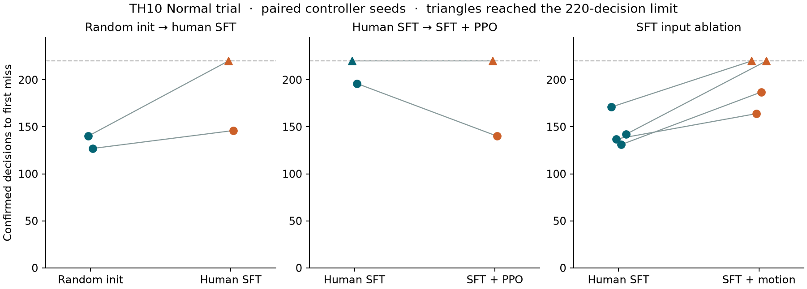
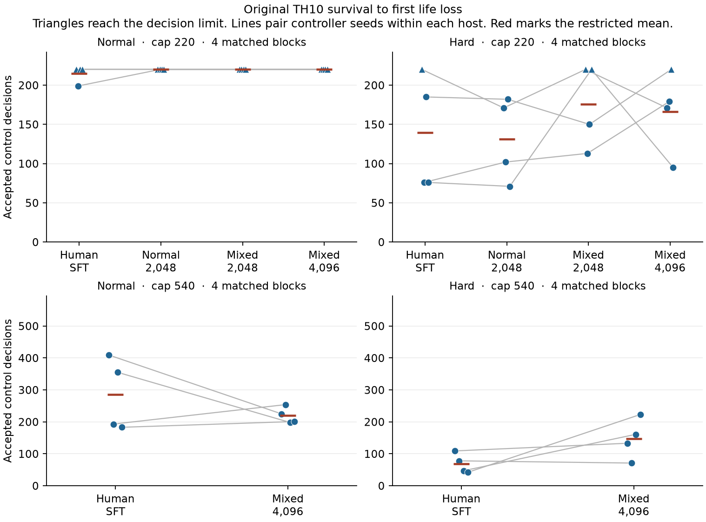
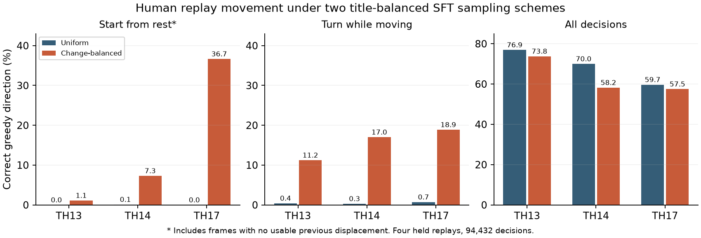

# Multi-title original-game rollout and policy transfer

Each panel is a crop of a separately captured original client. All three clients reached Normal Stage 1. The three captures were taken at different times. The TH14 Windows full-credit queue runs independently.

| Host | Original game and work completed | Measurement |
| --- | --- | --- |
| Momentum | RTX 5090 replay SFT on TH13/14/17. TH10 Normal + Hard and previous TH14 rollout lanes. | Both TH10 clients fed the same PPO learner, with 1,024 accepted decisions each. [Four-actor training journal](th10-rank-study/mixed-ppo/report.json) |
| Accelerator | TH10 Normal + Hard and previous TH14 rollout lanes. Uninterrupted TH10 story evaluation. | Both TH10 clients contributed another 1,024 decisions each. [Full-credit SFT and PPO comparison](../2026-11-25-th14-native-policy/th10-official-trial-frozen-credit-comparison.json) |
| Entropy | Held native TH10 evaluation on Normal + Hard, separate TH13 transfer check and previous TH14 lanes. | 32 frozen TH10 credits on a machine outside PPO training. [Normal](th10-rank-study/mixed-held-1/report.json) · [Hard](th10-rank-study/mixed-held-2/report.json) |
| Steam Deck | Two private TH12 clients for joint online training, original full-life evaluation and native-clock qualification. | 24 shared-cohort credits and four full credits to Game Over. [Full-credit video index](th12-full-credits/videos/) |
| Endeavour | Two private TH13 clients for joint online training, sensor tests and frozen full-life evaluation. | 24 shared-cohort credits. All 32 horizontal input blocks with a visible player at both endpoints moved in the requested direction. [Frozen progress recording](th13-full-credits/progress-4credits-sparse.mp4) |

TH10 has native position and stock measurements. TH12 and TH13 use private-display pixels and measured wall time here. Client restarts, episode counts and controller time stamps are recorded separately from native ticks. Completing a bounded opening with spare lives is insufficient evidence for a stage clear.

[TH10 native movement and score](th10-native-response.json) · [TH10 observations](th10-native.csv) · [TH10 input timestamps](th10-inputs.csv) · [Two TH13 clients](th13-two-instances.jpg) · [TH13 opening trials](th13-opening-inputs.json) · [TH13 episode hashes](../2026-11-25-multititle/th13-endeavour-original-trial.json) · [TH14 training cohort](../2026-11-25-th14-native-policy/train-only-trial-held12-corpus.json)

## Closed-loop TH14 result

Six original-game workers completed 72 fresh credits in a fixed 36-pair comparison. The endpoint is the first observed injury by native frame 1,700 in the trial's first stage. One arm sampled actions uniformly. The other repeatedly sampled among the four lowest predicted movement risks under the assigned focus. Injuries occurred in 35/36 uniform credits and 17/36 model-assisted credits. The paired risk reduction was 50 percentage points with a 95% host-stratified bootstrap interval of 33–67 points. Restricted mean survival rose from 826.1 to 1,419.2 native frames. All three physical hosts had a positive estimated difference. This result covers the TH14 opening and the two tested controllers. [Fixed trial assignments](th14-randomized-plan.json) · [Results by physical host](th14-closed-loop-outcomes.json) · [Untouched intervention cohort](th14-contact-held-episodes.json)

## Replay transfer and movement starts

Each arm trained from random initialization for 2,400 optimizer steps of 256 samples each. Titles were equally likely, with uniform samples within title in the primary comparison. The training pool contained 26,262 TH13, 89,645 TH14 and 100,443 TH17 original state/action records. The four held replays contribute 94,432 decisions. The fits excluded their players and checked for duplicate shard digests. The evaluation has one TH13 player, one TH14 player and two TH17 replays, so player diversity remains a limitation. TH15, TH18 and TH19 stayed outside this experiment.

| Evaluated title | Joint movement NLL | NLL training without that title | Exact direction on movement starts, uniform → switch sampling | Exact direction on turns, uniform → switch sampling |
| --- | ---: | ---: | ---: | ---: |
| TH13 | 0.830 | 0.838 | 11.33% → 13.28% | 15.53% → 18.45% |
| TH14 | 0.906 | 1.111 | 5.72% → 6.34% | 13.08% → 14.17% |
| TH17 | 1.096 | 1.142 | 6.42% → 7.82% | 13.37% → 15.95% |

Values average two optimization seeds. The transfer comparison holds total training draws fixed. The direction-change experiment replaces 25% of uniform draws with recorded action changes using training labels only. It was a follow-up after inspecting the uniform fit on these same four diagnostic replays. Start and turn accuracy rose on all three titles, while overall movement NLL worsened on all three. Frozen policies still need independent closed-loop evaluation. Frame counts alone cannot establish between-player or between-game uncertainty.

[Training logs and split fingerprints](transfer-matrix-live.json) · [Direction-change counts and previous-action baseline](switches.json) · [Switch-sampled fits](switch-training25.json) · [Switch-sampled evaluation](switches25.json)

## A common observation stream on three games

The first shared pixel cohort contains 53 fresh original-game credits and 4,000 executed transitions. TH10 supplied 5 × 32, TH12 supplied 24 × 80, and TH13 supplied 24 × 80. The fixed split contains 35 training, 9 development, and 9 test credits. The two Steam Deck lanes captured gameplay simultaneously for 58.32 seconds. The movie displays a training credit from each title at its measured elapsed time and overlays its logged action. [Three original rollout traces on video](three-original-rollouts.mp4) · [Three-title source hashes](three-title-episodes.json) · [TH10 episodes](th10-accelerator-episodes.json) · [TH12 episodes](th12-deck-episodes.json)

On the nine held credits, a one-step predictor conditioned only on elapsed time, title and current image beat frame copying on all three titles. Adding the executed controls failed to improve whole-image prediction. A second diagnostic trained to infer the horizontal key from the current and successor images was only slightly more accurate than using the current image alone. This limits the case for using these full-image dynamics losses to steer a player.

| Held game | Mean pixel MSE, copy | Time and title model | With action | Horizontal input decoded, current → image pair |
| --- | ---: | ---: | ---: | ---: |
| TH10, 1 credit | .013019 | .004563 | .004654 | 8/32 → 13/32 |
| TH12, 4 credits | .004778 | .002435 | .002474 | 104/320 → 108/320 |
| TH13, 4 credits | .002755 | .002351 | .002378 | 112/320 → 118/320 |

Four further TH13 credits from Entropy used the frozen policies and new controller seeds. Current-image versus paired-image decoding there was 116/320 versus 124/320. These were separate episodes on a second physical host. [Fixed protocol](pixel-protocol.json) · [Dynamics and shuffled-action scores](pixel-dynamics.json) · [Input-decoding confusion matrices](pixel-controls.json) · [External host results](th13-frozen-entropy.json)

The reward adapters were exercised separately. Four TH12 credits had two confirmed stored-life drops each, and remained playable at the 60-second time limit with zero spares. A TH13 credit displayed an active death trance at the boundary, so the collector also saves follow-up frames to distinguish an imminent loss from a settled one. [TH12 stock-drop timings](th12-first-stock-loss.json) · [TH13 60-second crossed controls](../2026-11-25-multititle/th13-60s-resource-probe.json)

## One online gradient from two games

Steam Deck played four TH12 credits and Endeavour played four TH13 credits using the exact same 255-parameter stochastic pixel actor. It samples left, release or right while holding Shoot. Each game used its own verified reward. TH12 supplied the fraction of 40 seconds survived before the first spare-life loss. TH13 supplied the settled 60-second spare-life change divided by three. The update used a leave-one-other-credit-out baseline within each game and gave the two game gradients equal weight. Before clipping, their norms were 3.476 and 0.368 and their cosine similarity was 0.158. The shared step changed the policy probabilities more on TH12.

Both hosts also reduced their retained native pixels and action probabilities locally. Eight compressed per-credit gradient packets totaled 16,009 bytes. Their raw pixel and behavior logs totaled 12,519,190 bytes. The largest weight discrepancy relative to central recomputation was 5.6 × 10⁻¹⁷. Research screenshots were archived separately. These counts cover application payload and exclude SSH framing. The 2,040-byte actor can run with only its preceding frame and the current screen. [Joint update](joint-th12-th13-update.json) · [Measured actor-side reduction](actor-side-reduction.json) · [Initial weights](joint-parent-255.npz) · [Updated weights](joint-policy-255.npz)

In fresh paired TH12 credits, joint versus initial first-loss survival was 8.75 versus ≥40 seconds and ≥40 versus ≥40 seconds. TH13 returned 0 versus 0 and −1 versus −1 in two new matched pairs. These results support the distributed update path. They give no positive held-out performance evidence for this shared update. [TH12 outcomes](joint-th12-held.json) · [TH13 outcomes](joint-th13-held.json) · [TH12 separate policy training](th12-native-training.json)

## Human SFT transferred into native TH10

The human movement/focus policy trained on TH13, TH14 and TH17 was evaluated in TH10 for the first time with fixed shooting and Bomb disabled. Both the replay loader and original worker use position, lives, focus and projectile observations. Two fixed-seed controls isolate the contribution of previous displacement sign. Its usefulness in human replay prediction was large, and it improved the restricted original-game survival horizon in all four matched controller-seed pairs. Native game RNG was uncontrolled.

| Frozen TH10 comparison | First arm, decisions to miss or limit | Second arm | Mean difference |
| --- | --- | --- | ---: |
| Random initialization → transferred human SFT | 140, 127 | ≥220, 146 | +49.5 |
| Frozen SFT → 256-step warm PPO | ≥220, 196 | ≥220, 140 | −28.0 |
| SFT without → with recent displacement | 171, 137, 131, 142 | ≥220, 164, 187, ≥220 | +52.5 |

The cap is 220 accepted control decisions. Censored values contribute 220 to the restricted mean. The stock readout and XY displacement come from the running game. A serving reply repeats the requested XTest mask. The position trace measures the character's response independently. The displacement-feature study held the SFT training budget and data fixed. In a separate 512-step scratch PPO pilot, three held Entropy credits improved over the frozen initialization by 14, 49 and 25 decisions. All six credits in that pilot ended with the first life loss. [Zero-shot comparison](th10-zero-shot.json) · [Warm PPO update](th10-warm-ppo.json) · [Frozen PPO comparison](th10-warm-ppo-held.json) · [Displacement ablation](th10-motion-held.json) · [Native action and stock traces](th10-traces/) · [External scratch PPO comparison](../2026-11-25-th14-native-policy/th10-official-trial-live-ppo-pilot.json) · [Model files](checkpoints/)

## Four concurrent TH10 environments and external evaluation

Momentum and Accelerator each served two isolated, visible-to-the-actor original TH10 trial clients, one on Normal and one on Hard. All four contributed 128 fresh movement/focus decisions per PPO update to a single learner initialized from the TH13/14/17 human SFT checkpoint. The learner completed 8 updates and accepted 4,096 transitions, divided equally among the four physical-host/difficulty combinations. The Normal-only run on the same two hosts accepted 2,048 transitions in 8 updates. Neither controller used geometric assistance, automatic bombing or aim correction. Shoot was held. The step reward was survival up to the first lost spare, with an explicit loss penalty.

| Training run | Accepted decisions | Decisions per second across successful updates | Discarded partial batch |
| --- | ---: | ---: | ---: |
| Two Normal instances, cold launches | 2,048 | 4.82 | 85 |
| Four instances, Normal and Hard, native Retry | 4,096 | 14.95 | 63 |

Successful-update time includes native stepping, any resets in those updates, and optimization. Rate excludes the failed attempts. Instance count, reset method, and rank mix all changed, so the ratio describes these deployed configurations. The matched reset-only benchmark on Momentum measured median cold start 26.68 seconds versus native in-process Retry 3.10 seconds. A retry after losing a life also restored the two starting spares, raw score zero and the original spawn coordinates. The four-instance training run subsequently recorded 33 successful warm retries (median 3.10 seconds) and eight cold starts (median 25.54 seconds). The learner restored its preceding checkpoint and discarded all fragments of an interrupted batch. [Reset benchmark](th10-rank-study/th10-native-retry/report.json) · [Normal training journal](th10-rank-study/two-host-ppo/report.json) · [Mixed training journal](th10-rank-study/mixed-ppo/report.json) · [Evaluation assignment](th10-rank-study/protocol.json)

The first external Normal comparison used four matched controller seeds on Entropy and a 220-decision limit. In order, SFT survived 206, ≥220, ≥220, ≥220 decisions. The Normal-only PPO checkpoint survived 201, ≥220, ≥220, ≥220. Three seed pairs hit the ceiling in both conditions. These short openings show little separation. [Raw decisions and frozen comparisons](th10-rank-study/two-host-held/)

## Original full-life tests

Steam Deck ran four original TH12 Normal credits. All four ended on the game's Game Over screen. In the first paired seed the transferred TH13 specialist lasted 128.29 seconds and its initial parent 53.90. In the second pair, after exchanging lanes, the times were 50.38 and 87.84. The first Nazrin gauge appeared in both Alpha-lane credits and neither Beta credit. Stage 2 arrival was 0/4. Time is elapsed wall time; the controller seeds were matched and the game RNG was uncontrolled. [Native stock and event logs](th12-full-credits/report.json) · [Timeline](th12-full-credits/stage1-timeline.png) · [All four original recordings](th12-full-credits/videos/) · [Original end screens](th12-full-credits/evidence/)

Endeavour tested the joint TH12/TH13 actor and a TH13-only specialist in four original TH13 Normal credits. In both pairs the joint actor reached the 180-second checkpoint with one spare life and the specialist with zero. All four had two Bombs and saw the same timed enemy. The first pair stopped there. Both runs in the second pair continued until the native ranking screen confirmed Stage 1. It appeared by 267.93 seconds for the joint actor (836,990 points) and by 204.47 for the specialist (540,320 points). Both ended before Stage 2. The capture samples the game display every three seconds. [Four-credit recording](th13-full-credits/progress-4credits-sparse.mp4) · [Stock, score and censoring](th13-full-credits/manifest.json)

TH13's software renderer saturated the original two-core quota per lane. During the same live timed encounter an increase to four cores per lane changed native countdown progress per wall second from 0.270 to 0.398 on one lane and from 0.254 to 0.386 on the other. The quota change occurred at different points in the attack, so the rates are descriptive. Wall-clock survival across machines can move independently of game-clock survival. [CPU scheduling and native countdown readings](th13-full-credits/cpu-native-clock.json)
### Frozen Normal and Hard results

Entropy completed the 32 preassigned frozen credits. Each cell gives the mean number of accepted control decisions to the first spare-life loss, restricted to 220. The parentheses give the number reaching the limit out of four. The arms share their human SFT parent. At 2,048 transitions, the mixed run had four 512-decision updates and the Normal-only run had eight 256-decision updates.

| Entropy difficulty | Human SFT | Normal PPO, 2,048 | Mixed PPO, 2,048 | Mixed PPO, 4,096 |
| --- | ---: | ---: | ---: | ---: |
| Normal | 214.75 (3) | 220 (4) | 220 (4) | 220 (4) |
| Hard | 139.25 (1) | 131.50 (0) | 175.75 (2) | 166.25 (1) |

To test the short Normal ceiling, the second protocol extended first-life measurement to 540 accepted controls. Momentum and Accelerator each repeated the same two new controller seeds on both difficulties. All 16 credits ended in actual life loss. Human SFT versus mixed PPO (4,096) averaged **285.0 versus 219.5** on Normal, and **69.0 versus 147.0** on Hard. Each mean uses four host/seed blocks spanning two unique controller seeds. This is evidence of a difficulty-dependent trade-off. It leaves both native RNG and small-sample uncertainty. [External frozen credit journals](th10-rank-study/) · [Preassigned longer-horizon protocol](th10-rank-study/long-opening-protocol.json) · [Values behind the figure](th10-curricula.json)

The earlier two-host Normal-only publication journal retained a hardcoded host display name from a previous run. Its deployment manifest assigned this evaluation to Entropy. The evaluator now takes the machine label from its worker configuration. The separate 32-credit evaluation recorded the assigned host per lane. [Original host assignment](two-host-protocol.json)

In uninterrupted Normal credits with every starting life, motion SFT and Normal-only PPO both reached the original Game Over screen during Stage 1. The first spare was lost at decisions 159 and 164, respectively. Final life loss was at 363 and 356, with native raw scores of 110,628 and 131,264. All 719 consumed game key masks matched the policy requests. The original spawned the player beyond the earlier sensor's playfield limit during respawn. The revised runner retained these transitions. [Full-credit audit, endpoints and technical attempts](../2026-11-25-th14-native-policy/th10-official-trial-frozen-credit-comparison.json) · [SFT recording from an additional full credit](th10-full-credits/representative-native-sft.mp4) · [PPO recording from the paired credit](th10-full-credits/representative-native-ppo.mp4)

On Steam Deck, six fresh credits with identical controller draws crossed the CPU allocation 2 → 3 → 2 cores per TH12 client. The two clients' median in-game HUD frame rates went 34.5/34.7 → 46.15/46.0 → 32.0/32.25. CPU throttling fell from 100% to about 5% of measured periods at three cores. Both clients now use the three-core setting. The previous Alpha/Beta discrepancy remains unexplained by a stable game-speed difference. [Six-credit benchmark and deployment profile](../2026-11-25-multititle/th12-deck-native-clock-ab.md)
## Learning to change direction across titles

We re-scored the strongest prior-displacement TH13/14/17 movement/focus SFT policy against the simple predictor that repeats the last observed displacement direction. On the four reserved human replays, the neural policy's greedy action was correct on 76.95%, 70.02% and 59.70% of all decisions. Repeating the previous direction gave 76.96%, 70.30% and 59.91%. When the player changed to a different non-neutral direction, the policy was correct only 9/2,136, 10/3,278 and 59/8,181 times. Ordinary movement accuracy hid a failure to initiate and steer.

Two fresh 5090 fits used the same observation, optimizer budget (2,400 × 256), random initialization seed and three equally sampled training titles. Masking the previous displacement on 30% of training examples worsened held movement NLL on all three titles. A second fit retained that input and sampled 40% continuing action, 20% movement starts, 25% turns and 15% stops within each title. Movement labels remained the original expert action distributions. On held human replays the balanced fit increased exact turn accuracy to 11.24%, 17.02% and 18.89%. Exact starts improved from 0.00%, 0.12%, 0.00% to 1.12%, 7.32%, 36.66%. Aggregate greedy accuracy fell on all three titles. A zero prior direction includes an unavailable displacement at a discontinuity. These diagnostics reuse a small development cohort of four held replays. [Counts, conditional losses and persistence](balance-metrics.json) · [History masking control](inertia-metrics.json) · [Frozen fitting protocol](balance-changes-protocol.json) · [Models and optimizer histories](th10-shared-sft/)

