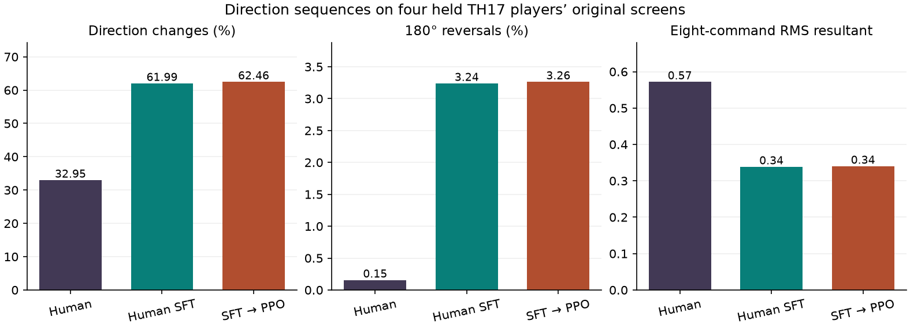

# Consecutive movement commands on identical human screens

Four previously examined TH17 players supplied eight synchronized Hard and Lunatic stages. The comparison follows the same human screens and the same adjacent four-tick observation pairs. Human directions are observed at camera boundaries. The policies independently sample their learned direction distribution at each boundary. The table uses their exact expected counts.

| Controller | Adjacent directions | Change direction | Directly reverse | Issue neutral | Eight-command RMS resultant |
|---|---:|---:|---:|---:|---:|
| Human | 24,613 | 32.95% | 0.15% | 42.75% | 0.572 |
| Human SFT | 24,613 | 61.99% | 3.24% | 49.11% | 0.338 |
| SFT → PPO | 24,613 | 62.46% | 3.26% | 48.64% | 0.340 |

The eight-command measure sums unit direction vectors (zero for neutral), divides by eight, and reports the root mean square length across windows. Opposing commands cancel. The upper bound is one. Actual travel also depends on focus speed, boundaries, game state and which screen earlier actions produce.

## Commands issued during six-game PPO collection

Each cell contains 16 ordinary original training starts under the previous six-title policy. Adjacent decisions can cover different native durations across games. These rows use the sampled action log from the policy’s own play. Native key-readback audits are linked separately.

| Title | Difficulty | Adjacent commands | Changed direction | Directly reversed |
|---|---|---:|---:|---:|
| TH08 | Hard | 11,970 | 68.40% | 4.29% |
| TH08 | Lunatic | 10,960 | 68.55% | 4.30% |
| TH10 | Hard | 3,933 | 58.68% | 3.41% |
| TH10 | Lunatic | 2,967 | 59.42% | 3.10% |
| TH11 | Hard | 3,830 | 65.69% | 4.20% |
| TH11 | Lunatic | 3,768 | 63.93% | 3.69% |
| TH12 | Hard | 9,701 | 69.33% | 5.44% |
| TH12 | Lunatic | 8,526 | 72.67% | 6.42% |
| TH13 | Hard | 10,718 | 56.65% | 3.35% |
| TH13 | Lunatic | 8,658 | 59.39% | 3.66% |
| TH17 | Hard | 17,375 | 63.71% | 3.67% |
| TH17 | Lunatic | 13,665 | 65.82% | 3.77% |

[Per-stage human evidence](held-human-screens.json) · [All 192 native action sequences](actual-six-title-commands.json) · [TH10, TH11, TH13 readback](../six-game-return-horizon/three-title-original-action-coverage.json) · [TH08, TH12, TH17 readback](../six-game-return-horizon/th08-th12-th17-original-action-coverage.json)
