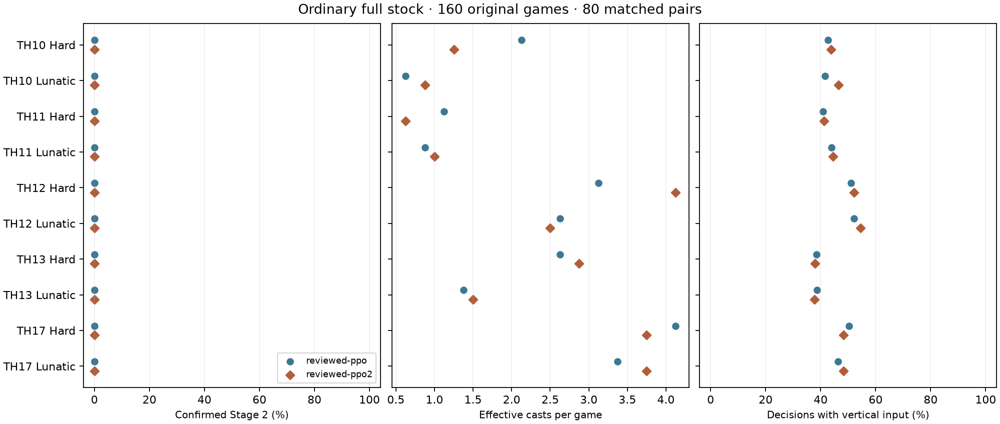

# Paired full-stock original-game results

The full evaluation contains 160 ordinary original-game starts and 80 matched pairs for reviewed-ppo and reviewed-ppo2. Both arms use the same build and host within each pair. In-game randomness is uncontrolled.

| Original game | Stage 2, reference → candidate | Mean spare lives at end | Mean Bombs or Power at end | Confirmed casts, reference → candidate |
|---|---:|---:|---:|---:|
| TH10 Hard | 0/8 → 0/8 | 0.00 → 0.00 | Power 0.544 → 0.131 | 17 → 10 |
| TH10 Lunatic | 0/8 → 0/8 | 0.00 → 0.00 | Power 0.213 → 0.231 | 5 → 7 |
| TH11 Hard | 0/8 → 0/8 | 0.00 → 0.00 | Power 0.000 → 0.000 | 9 → 5 |
| TH11 Lunatic | 0/8 → 0/8 | 0.00 → 0.00 | Power 0.000 → 0.000 | 7 → 8 |
| TH12 Hard | 0/8 → 0/8 | 0.00 → 0.00 | Bomb 0.625 → 0.750 | 25 → 33 |
| TH12 Lunatic | 0/8 → 0/8 | 0.00 → 0.00 | Bomb 0.500 → 1.375 | 21 → 20 |
| TH13 Hard | 0/8 → 0/8 | 0.00 → 0.00 | Bomb 1.000 → 0.625 | 21 → 23 |
| TH13 Lunatic | 0/8 → 0/8 | 0.00 → 0.00 | Bomb 1.125 → 0.875 | 11 → 12 |
| TH17 Hard | 0/8 → 0/8 | 0.00 → 0.00 | last playable Bomb 2.000 → 2.000 | 33 → 30 |
| TH17 Lunatic | 0/8 → 0/8 | 0.00 → 0.00 | last playable Bomb 2.500 → 2.125 | 27 → 30 |

[Full-stock records](credits.json) · [Input and resource counts](whole-game-controls.json) · [Paired results by difficulty](paired-by-difficulty.json) · [Full Hard recording](https://github.com/Moonbow1969/touhou-training/releases/download/camera-training-2026-11-26/chained-five-game-ppo-first-hard-native-credits.mp4) · [Full Lunatic recording](https://github.com/Moonbow1969/touhou-training/releases/download/camera-training-2026-11-26/chained-five-game-ppo-first-lunatic-native-credits.mp4)

TH12 pairs with complete input coverage in both arms include 8/8 Hard, 8/8 Lunatic. The main table uses every verified physical endpoint. [Resources and Stage 2 in both populations](th12-physical-and-qualified.json)
