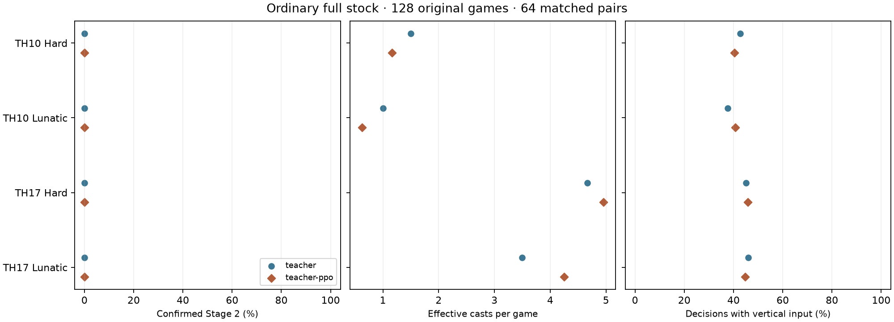

# Paired full-stock original-game results

The full evaluation contains 128 ordinary original-game starts and 64 matched pairs for teacher and teacher-ppo. Both arms use the same build and host within each pair. In-game randomness is uncontrolled.

| Original game | Stage 2, reference → candidate | Mean spare lives at end | Mean Bombs or Power at end | Confirmed casts, reference → candidate |
|---|---:|---:|---:|---:|
| TH10 Hard | 0/24 → 0/24 | 0.00 → 0.00 | Power 0.446 → 0.525 | 36 → 28 |
| TH10 Lunatic | 0/8 → 0/8 | 0.00 → 0.00 | Power 0.294 → 0.319 | 8 → 5 |
| TH17 Hard | 0/24 → 0/24 | 0.00 → 0.00 | last playable Bomb 1.542 → 1.625 | 112 → 119 |
| TH17 Lunatic | 0/8 → 0/8 | 0.00 → 0.00 | last playable Bomb 2.250 → 1.875 | 28 → 34 |

[Full-stock records](credits.json) · [Input and resource counts](whole-game-controls.json) · [Paired results by difficulty](paired-by-difficulty.json) · [Full Hard recording](https://github.com/Moonbow1969/touhou-training/releases/download/camera-training-2026-11-26/feedback-ppo-independent-replication-first-hard-native-credits.mp4) · [Full Lunatic recording](https://github.com/Moonbow1969/touhou-training/releases/download/camera-training-2026-11-26/feedback-ppo-independent-replication-first-lunatic-native-credits.mp4)

On the 24 new Hard pairs per title, the mean PPO minus SFT difference in the last native Stage 1 tick was −204.54 on TH10 and −74.13 on TH17. Exact two-sided blocked randomization gave unadjusted p = 0.2320 and 0.7897, respectively. Holm-adjusted p-values were 0.4640 and 0.7897. Neither previous Hard improvement replicated on these independent starts. [Prespecified paired tests](hard-replication.json)
