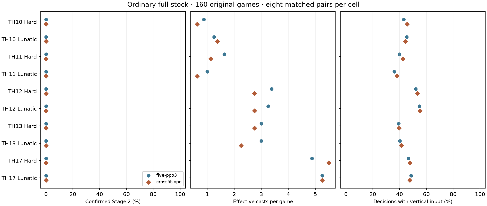

# Paired full-stock original-game results

Every title and difficulty supplied eight matched seeds for five-ppo3 and crossfit-ppo. The full evaluation contains 160 ordinary original-game starts. Both arms use the same build and host within each pair. In-game randomness is uncontrolled.

| Original game | Stage 2, reference → candidate | Mean spare lives at end | Mean Bombs or Power at end | Confirmed casts, reference → candidate |
|---|---:|---:|---:|---:|
| TH10 Hard | 0/8 → 0/8 | 0.00 → 0.00 | Power 0.206 → 0.250 | 7 → 5 |
| TH10 Lunatic | 0/8 → 0/8 | 0.00 → 0.00 | Power 0.406 → 0.463 | 10 → 11 |
| TH11 Hard | 0/8 → 0/8 | 0.00 → 0.00 | Power 0.000 → 0.000 | 13 → 9 |
| TH11 Lunatic | 0/8 → 0/8 | 0.00 → 0.00 | Power 0.000 → 0.000 | 8 → 5 |
| TH12 Hard | 0/8 → 0/8 | 0.00 → 0.00 | Bomb 1.125 → 1.250 | 27 → 22 |
| TH12 Lunatic | 0/8 → 0/8 | 0.00 → 0.00 | Bomb 0.625 → 0.875 | 26 → 22 |
| TH13 Hard | 0/8 → 0/8 | 0.00 → 0.00 | Bomb 0.250 → 0.875 | 24 → 22 |
| TH13 Lunatic | 0/8 → 0/8 | 0.00 → 0.00 | Bomb 0.500 → 0.625 | 24 → 18 |
| TH17 Hard | 0/8 → 0/8 | 0.00 → 0.00 | Last playable Bombs 1.625 → 1.625 | 39 → 44 |
| TH17 Lunatic | 0/8 → 0/8 | 0.00 → 0.00 | Last playable Bombs 1.125 → 0.875 | 42 → 42 |

[Full-stock records](credits.json) · [Input and resource counts](whole-game-controls.json) · [Paired results by difficulty](paired-by-difficulty.json) · [Full Hard recording](https://github.com/Moonbow1969/touhou-training/releases/download/camera-training-2026-11-26/five-game-crossfit-advantages-first-hard-native-credits.mp4) · [Full Lunatic recording](https://github.com/Moonbow1969/touhou-training/releases/download/camera-training-2026-11-26/five-game-crossfit-advantages-first-lunatic-native-credits.mp4)

## TH12 native control coverage

All 32 assigned original credits had a verified Stage 1 loss. The physical tick sampler missed one tick in the reference Lunatic credit 1681266. Its terminal and actions remain recorded. Continuous input coverage qualified in 31 of 32 credits, leaving seven complete Lunatic pairs for sensitivity analysis. The Lunatic candidate ended a mean 225 ticks earlier over all eight pairs and 250 ticks earlier over seven strictly qualified pairs. The two-sided exact permutation test respects the original lane and arm-order allocation (16 assignments per difficulty, Lunatic p = .125 and Hard p = .625). Both arms reached Stage 2 in 0/80 full credits across all five games.

[Native endpoint evidence](../th12-endpoint-only-1681266.json) · [Complete-case analysis](../th12-held-native-event-pairs.json) · [Order-constrained permutation test](../th12-blocked-order-sensitivity.json)
