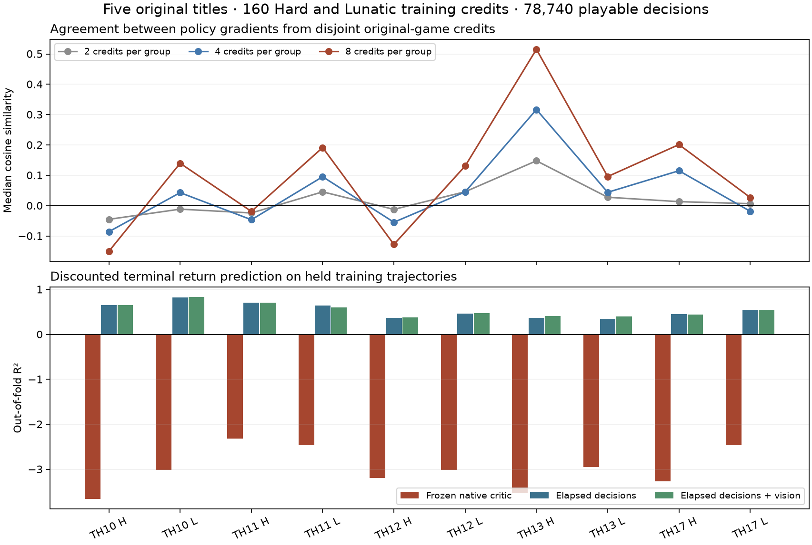

# Third five-game PPO generation

One full-action camera policy trained on 160 new full-stock original-game credits and 78,740 playable decisions. Each of the five games contributed 16 Hard and 16 Lunatic credits. The frozen second-generation actor supplied every rollout. All four optimization epochs passed the KL limit. The largest measured title-by-rank joint KL was 0.00759. The deployed actor SHA-256 is `b7d33148162c8a547a7cd9f49bca30d8e5f83053fb8a8c5f899d116ab5f57fd2`. [Per-game data and training stocks](verified-training-by-rank.json) · [Learner log](policy/report.json) · [TorchScript actor](policy/policy.ts) · [Raw training archive](release-archive.json) · [Native reward corrections](optimizer-reward-corrections.zip)

The registered ordinary-stock evaluation compares the second and third generation on eight new seed pairs in each game and difficulty. Both arms use the same host and build within a pair. Seeds control policy sampling. Original game randomness is uncontrolled. Primary outcome is reaching Stage 2 before using a continue. Secondary outcomes include native progress, spare lives, and Bombs or Power. [Evaluation registration](camera-protocol.json)

## Value prediction and initial gradient agreement

The frozen second-generation critic overestimated discounted terminal return in all ten cells. Across the cells its held-trajectory R² ranged from −3.66 to −2.32. A ridge model using elapsed decisions alone reached 0.35 to 0.82. Each prediction came from a model fitted on twelve other complete training games of the same title and difficulty. In TH13 Hard the median gradient cosine across independent groups rose from 0.15 at two trajectories per group to 0.52 at eight. In TH10 Hard it changed from −0.05 to −0.15. These diagnostics motivated a comparison using the same native actions and rewards with cross-fitted actor advantages. [Folds and prediction errors](critic-qualification/report.json) · [Gradient sampling variation](gradient-by-credit-count.json) · [Follow-up game registration](../five-game-crossfit-advantages/camera-protocol.json)

## Hard and Lunatic coverage through this update and the first TH08 update

The ledger counts each distinct original training credit once across fitted models. Repeated epochs and reevaluated checkpoints add zero physical credits. Early TH12 data predates the continuous live-control audit. Every third-generation TH12 credit has independent evidence of continuous play. TH08 and these five titles use original trial builds for this online series. Retail human replay SFT has separate sampling and exposure counts. [All studies, fingerprints and denominators](../learning-curves/hard-lunatic-training-coverage.json)

| Original | Hard credits | Hard decisions | Lunatic credits | Lunatic decisions |
|---|---:|---:|---:|---:|
| TH08 | 4 | 2,672 | 4 | 1,684 |
| TH10 | 64 | 15,761 | 64 | 12,615 |
| TH11 | 32 | 7,202 | 32 | 6,942 |
| TH12 | 56 | 26,820 | 56 | 22,881 |
| TH13 | 56 | 43,424 | 56 | 32,513 |
| TH17 | 48 | 38,602 | 48 | 28,882 |
