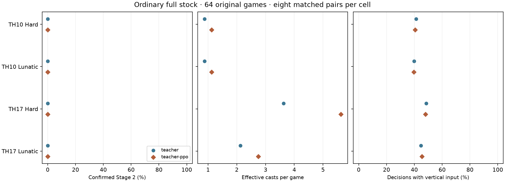

# Paired full-stock original-game results

Every title and difficulty supplied eight matched seeds for teacher and teacher-ppo. The full evaluation contains 64 ordinary original-game starts. Both arms use the same build and host within each pair. In-game randomness is uncontrolled.

| Original game | Stage 2, reference → candidate | Mean spare lives at end | Mean Bombs or Power at end | Confirmed casts, reference → candidate |
|---|---:|---:|---:|---:|
| TH10 Hard | 0/8 → 0/8 | 0.00 → 0.00 | Power 0.331 → 0.613 | 7 → 9 |
| TH10 Lunatic | 0/8 → 0/8 | 0.00 → 0.00 | Power 0.525 → 0.244 | 7 → 9 |
| TH17 Hard | 0/8 → 0/8 | 0.00 → 0.00 | last playable Bomb 2.000 → 1.500 | 29 → 45 |
| TH17 Lunatic | 0/8 → 0/8 | 0.00 → 0.00 | last playable Bomb 2.375 → 2.375 | 17 → 22 |

[Full-stock records](credits.json) · [Input and resource counts](whole-game-controls.json) · [Paired results by difficulty](paired-by-difficulty.json) · [Full Hard recording](https://github.com/Moonbow1969/touhou-training/releases/download/camera-training-2026-11-26/four-step-feedback-online-first-hard-native-credits.mp4) · [Full Lunatic recording](https://github.com/Moonbow1969/touhou-training/releases/download/camera-training-2026-11-26/four-step-feedback-online-first-lunatic-native-credits.mp4)

Hard Stage 1 lasted 384.5 ticks longer on average in TH10 (6 wins in 8 pairs) and 1,102.375 ticks longer in TH17 (7 wins in 8). Two-sided exploratory sign tests gave p = 0.289 and 0.070. Native randomness was uncontrolled. [Paired differences and uncertainty by difficulty](../two-title-stage1-sign-sensitivity.json) · [Independent replication protocol](../../feedback-ppo-independent-replication/camera-protocol.json)
