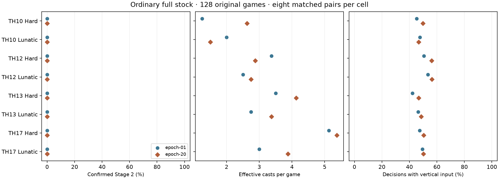

# Paired full-stock original-game results

Every title and difficulty supplied eight matched seeds for epoch-01 and epoch-20. The full evaluation contains 128 ordinary original-game starts. Both arms use the same build and host within each pair. In-game randomness is uncontrolled.

| Original game | Stage 2, reference → candidate | Mean spare lives at end | Mean Bombs or Power at end | Confirmed casts, reference → candidate |
|---|---:|---:|---:|---:|
| TH10 Hard | 0/8 → 0/8 | 0.00 → 0.00 | Power 0.231 → 0.300 | 10 → 21 |
| TH10 Lunatic | 0/8 → 0/8 | 0.00 → 0.00 | Power 0.212 → 0.256 | 16 → 12 |
| TH12 Hard | 0/8 → 0/8 | 0.00 → 0.00 | Bomb 1.000 → 0.875 | 27 → 23 |
| TH12 Lunatic | 0/8 → 0/8 | 0.00 → 0.00 | Bomb 1.500 → 1.000 | 20 → 22 |
| TH13 Hard | 0/8 → 0/8 | 0.00 → 0.00 | Bomb 0.750 → 0.625 | 28 → 33 |
| TH13 Lunatic | 0/8 → 0/8 | 0.00 → 0.00 | Bomb 0.625 → 0.750 | 22 → 27 |
| TH17 Hard | 0/8 → 0/8 | 0.00 → 0.00 | last playable Bomb 0.375 → 0.875 | 41 → 43 |
| TH17 Lunatic | 0/8 → 0/8 | 0.00 → 0.00 | last playable Bomb 2.375 → 1.500 | 24 → 31 |

[Full-stock records](credits.json) · [Input and resource counts](whole-game-controls.json) · [Paired results by difficulty](paired-by-difficulty.json) · [Full Hard recording](https://github.com/Moonbow1969/touhou-training/releases/download/camera-training-2026-11-26/full-epochs-original-first-hard-native-credits.mp4) · [Full Lunatic recording](https://github.com/Moonbow1969/touhou-training/releases/download/camera-training-2026-11-26/full-epochs-original-first-lunatic-native-credits.mp4)

TH12 pairs with complete input coverage in both arms include 7/8 Hard, 6/8 Lunatic. The main table uses every verified physical endpoint. [Resources and Stage 2 in both populations](th12-physical-and-qualified.json)

The TH12 Lunatic clip for epoch 20 (seed 1821252) displays the sampled commands. Its native input log has a gap. The terminal screenshot and Stage 1 Game Over are verified.
