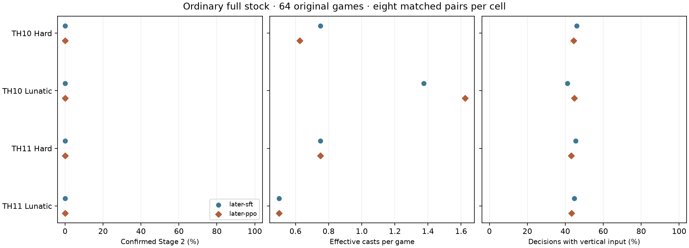

# Paired full-stock original-game results

Every title and difficulty supplied eight matched seeds for later-sft and later-ppo. The full evaluation contains 64 ordinary original-game starts. Both arms use the same build and host within each pair. In-game randomness is uncontrolled.

| Original game | Stage 2, reference → candidate | Mean spare lives at end | Mean Bombs or Power at end | Confirmed casts, reference → candidate |
|---|---:|---:|---:|---:|
| TH10 Hard | 0/8 → 0/8 | 0.00 → 0.00 | Power 0.181 → 0.050 | 6 → 5 |
| TH10 Lunatic | 0/8 → 0/8 | 0.00 → 0.00 | Power 0.081 → 0.331 | 11 → 13 |
| TH11 Hard | 0/8 → 0/8 | 0.00 → 0.00 | Power 0.000 → 0.000 | 6 → 6 |
| TH11 Lunatic | 0/8 → 0/8 | 0.00 → 0.00 | Power 0.000 → 0.000 | 4 → 4 |

[Full-stock records](credits.json) · [Input and resource counts](whole-game-controls.json) · [Paired results by difficulty](paired-by-difficulty.json) · [Full Hard recording](https://github.com/Moonbow1969/touhou-training/releases/download/camera-training-2026-11-26/later-human-online-first-hard-native-credits.mp4) · [Full Lunatic recording](https://github.com/Moonbow1969/touhou-training/releases/download/camera-training-2026-11-26/later-human-online-first-lunatic-native-credits.mp4)

