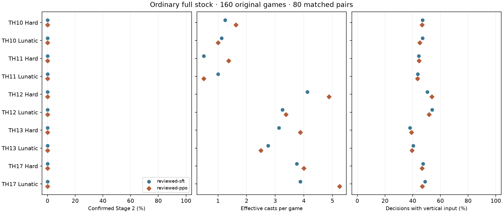

# Paired full-stock original-game results

Every title and difficulty supplied eight matched seeds for reviewed-sft and reviewed-ppo. The full evaluation contains 160 ordinary original-game starts. Both arms use the same build and host within each pair. In-game randomness is uncontrolled.

| Original game | Stage 2, reference → candidate | Mean spare lives at end | Mean Bombs or Power at end | Confirmed casts, reference → candidate |
|---|---:|---:|---:|---:|
| TH10 Hard | 0/8 → 0/8 | 0.00 → 0.00 | Power 0.212 → 0.319 | 10 → 13 |
| TH10 Lunatic | 0/8 → 0/8 | 0.00 → 0.00 | Power 0.037 → 0.269 | 9 → 8 |
| TH11 Hard | 0/8 → 0/8 | 0.00 → 0.00 | Power 0.000 → 0.000 | 4 → 11 |
| TH11 Lunatic | 0/8 → 0/8 | 0.00 → 0.00 | Power 0.000 → 0.000 | 8 → 4 |
| TH12 Hard | 0/8 → 0/8 | 0.00 → 0.00 | Bomb 0.875 → 0.500 | 33 → 39 |
| TH12 Lunatic | 0/8 → 0/8 | 0.00 → 0.00 | Bomb 1.375 → 1.000 | 26 → 27 |
| TH13 Hard | 0/8 → 0/8 | 0.00 → 0.00 | Bomb 0.875 → 0.750 | 25 → 31 |
| TH13 Lunatic | 0/8 → 0/8 | 0.00 → 0.00 | Bomb 1.125 → 1.375 | 22 → 20 |
| TH17 Hard | 0/8 → 0/8 | 0.00 → 0.00 | last playable Bomb 2.375 → 2.250 | 30 → 32 |
| TH17 Lunatic | 0/8 → 0/8 | 0.00 → 0.00 | last playable Bomb 1.875 → 1.625 | 31 → 42 |

[Full-stock records](credits.json) · [Input and resource counts](whole-game-controls.json) · [Paired results by difficulty](paired-by-difficulty.json) · [Full Hard recording](https://github.com/Moonbow1969/touhou-training/releases/download/camera-training-2026-11-26/reviewed-five-human-online-first-hard-native-credits.mp4) · [Full Lunatic recording](https://github.com/Moonbow1969/touhou-training/releases/download/camera-training-2026-11-26/reviewed-five-human-online-first-lunatic-native-credits.mp4)

TH12 pairs with complete input coverage in both arms include 8/8 Hard, 7/8 Lunatic. The main table uses every verified physical endpoint. [Resources and Stage 2 in both populations](th12-physical-and-qualified.json)
