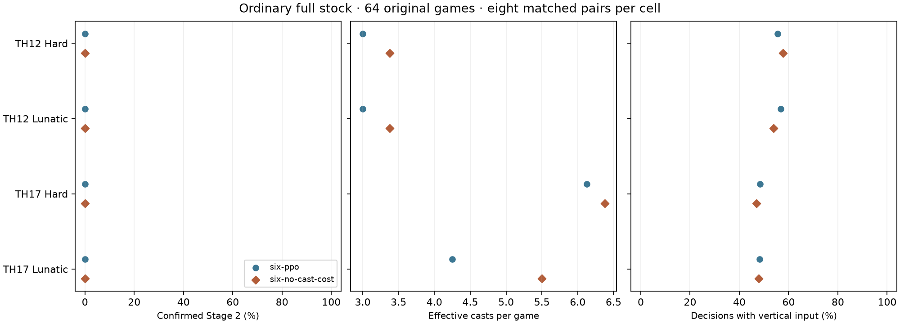

# Paired full-stock original-game results

Every title and difficulty supplied eight matched seeds for six-ppo and six-no-cast-cost. The full evaluation contains 64 ordinary original-game starts. Both arms use the same build and host within each pair. In-game randomness is uncontrolled.

| Original game | Stage 2, reference → candidate | Mean spare lives at end | Mean Bombs or Power at end | Confirmed casts, reference → candidate |
|---|---:|---:|---:|---:|
| TH12 Hard | 0/8 → 0/8 | 0.00 → 0.00 | Bomb 1.000 → 0.875 | 24 → 27 |
| TH12 Lunatic | 0/8 → 0/8 | 0.00 → 0.00 | Bomb 1.375 → 1.000 | 24 → 27 |
| TH17 Hard | 0/8 → 0/8 | 0.00 → 0.00 | last playable Bomb 1.250 → 0.875 | 49 → 51 |
| TH17 Lunatic | 0/8 → 0/8 | 0.00 → 0.00 | last playable Bomb 1.750 → 1.625 | 34 → 44 |

[Full-stock records](credits.json) · [Input and resource counts](whole-game-controls.json) · [Paired results by difficulty](paired-by-difficulty.json) · [Full Hard recording](https://github.com/Moonbow1969/touhou-training/releases/download/camera-training-2026-11-26/six-game-bomb-cost-first-hard-native-credits.mp4) · [Full Lunatic recording](https://github.com/Moonbow1969/touhou-training/releases/download/camera-training-2026-11-26/six-game-bomb-cost-first-lunatic-native-credits.mp4)

TH12 had independently confirmed original endpoints in all 32 credits. Both arms met the stricter input-coverage criterion on seven of eight Hard pairs and six of eight Lunatic pairs. TH17 Lunatic spent 4.25 → 5.50 Bombs per credit and progressed from mean Stage 1 tick 3,043.625 to 3,515.875. The exact two-sided tests using the randomized order within each lane gave p=.125 for Bomb use and p=.25 for progress. [TH12 coverage populations](th12-physical-and-qualified.json) · [Order-randomization analysis](../exact-order-native-sensitivity.json)
