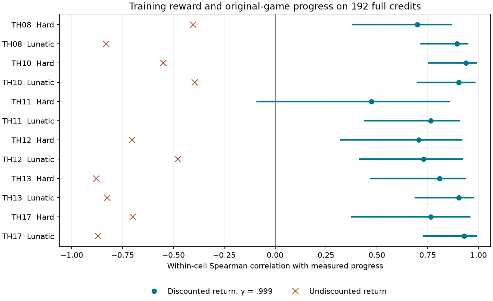

# Does the training reward rank original-game progress?

In the first joint six-game PPO batch, each title supplied 16 Hard and 16 Lunatic ordinary credits. For each credit we measured progress independently of its total reward. TH08 uses elapsed physical gameplay time, TH11 uses the settled original score and the other games use the Stage 1 native clock. Each interval resamples complete games within rollout host. All 192 credits came from training.

| Title | Rank | Discounted return vs. progress, Spearman ρ [95% interval] | Undiscounted return vs. progress | Decision count vs. progress |
|---|---|---:|---:|---:|
| TH08 | Hard | 0.70 [0.38, 0.87] | -0.40 | 0.99 |
| TH08 | Lunatic | 0.89 [0.72, 0.95] | -0.83 | 1.00 |
| TH10 | Hard | 0.94 [0.76, 0.99] | -0.55 | 1.00 |
| TH10 | Lunatic | 0.90 [0.70, 0.98] | -0.39 | 1.00 |
| TH11 | Hard | 0.47 [-0.09, 0.86] | constant | 0.72 |
| TH11 | Lunatic | 0.76 [0.44, 0.91] | constant | 0.82 |
| TH12 | Hard | 0.71 [0.32, 0.92] | -0.70 | 1.00 |
| TH12 | Lunatic | 0.73 [0.42, 0.92] | -0.48 | 1.00 |
| TH13 | Hard | 0.81 [0.47, 0.94] | -0.88 | 0.99 |
| TH13 | Lunatic | 0.90 [0.69, 0.97] | -0.83 | 1.00 |
| TH17 | Hard | 0.76 [0.38, 0.96] | -0.70 | 0.97 |
| TH17 | Lunatic | 0.93 [0.73, 0.99] | -0.87 | 0.99 |

All twelve discounted point estimates were positive. The undiscounted sum was negatively correlated with progress in ten cells. Both TH11 cells had exactly −3 total reward in every game. Discounting rewards later deaths less severely and gives the objective a survival signal even when every run exhausts all three lives. This association describes the reward received by the behavior policy. It does not establish that PPO learned to survive longer, or that Bombs caused the negative undiscounted correlation.

[Per-credit observations and intervals](report.json) · [Frozen analysis](protocol.json)
