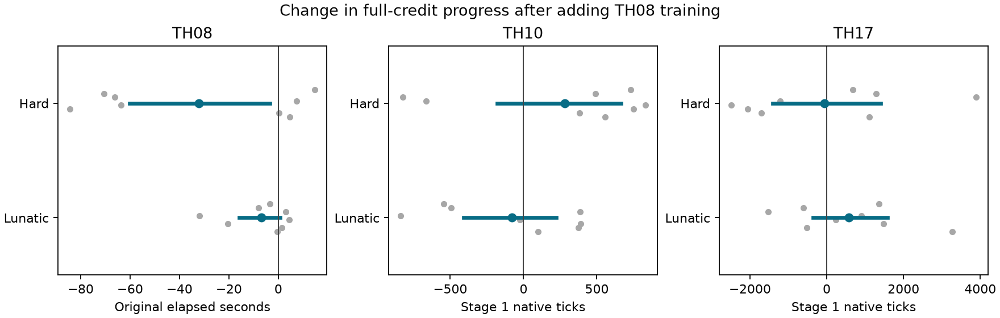

# Five-title and six-title PPO on 96 ordinary original credits

Both policies start from the same five-title generation-two actor and use the same 160 original games on TH10, 11, 12, 13 and 17. The six-title fit also used 32 TH08 games, with equal weight per game and difficulty. The comparison evaluates TH08 acquisition and retention on TH10 and TH17. Each difficulty supplied eight independent held controller seeds per title. The two policies shared a build and host within every pair. Native game randomness was uncontrolled.

| Game | Difficulty | Stage 2, five → six | Mean spare lives | Last playable Bombs or final Power | Mean progress, five → six | Paired change [95% interval] |
|---|---|---:|---:|---:|---:|---:|
| TH08 | Hard | 0/8 → 0/8 | 0.0 → 0.0 | Bombs 1.500 → 1.250 | 101.1 → 68.9 s | -32.2 [-60.1, -3.5] |
| TH08 | Lunatic | 0/8 → 0/8 | 0.0 → 0.0 | Bombs 1.625 → 1.250 | 66.3 → 59.5 s | -6.8 [-15.9, +0.7] |
| TH10 | Hard | 0/8 → 0/8 | 0.0 → 0.0 | Power 0.188 → 0.281 | 1,780.6 → 2,061.6 ticks | +281.0 [-179.5, +664.4] |
| TH10 | Lunatic | 0/8 → 0/8 | 0.0 → 0.0 | Power 0.406 → 0.312 | 1,564.5 → 1,483.2 ticks | -81.2 [-407.6, +223.6] |
| TH17 | Hard | 0/8 → 0/8 | 0.0 → 0.0 | Bombs 1.625 → 1.125 | 4,659.1 → 4,596.4 ticks | -62.8 [-1,405.8, +1,400.4] |
| TH17 | Lunatic | 0/8 → 0/8 | 0.0 → 0.0 | Bombs 2.375 → 1.250 | 2,454.5 → 3,027.1 ticks | +572.6 [-362.0, +1,575.8] |

Both arms exhausted stock on Stage 1 in all 48 games. On TH08 Hard, adding TH08 training corresponded to a shorter mean credit in this cohort. The intervals describe paired original trials and do not adjust for multiple endpoints. TH08 measures elapsed play to the first Continue. The other two games measure the last observed playable Stage 1 tick. The TH17 score screen resets Bombs, so the table uses the last playable inventory.

[All matched results](three-game-results.json) · [TH08 stock records and original colour recordings](evaluation/TH08.md) · [TH10 and TH17 stock records and videos](evaluation/README.md) · [Initial training gradient alignment](initial-gradients/report.json)
