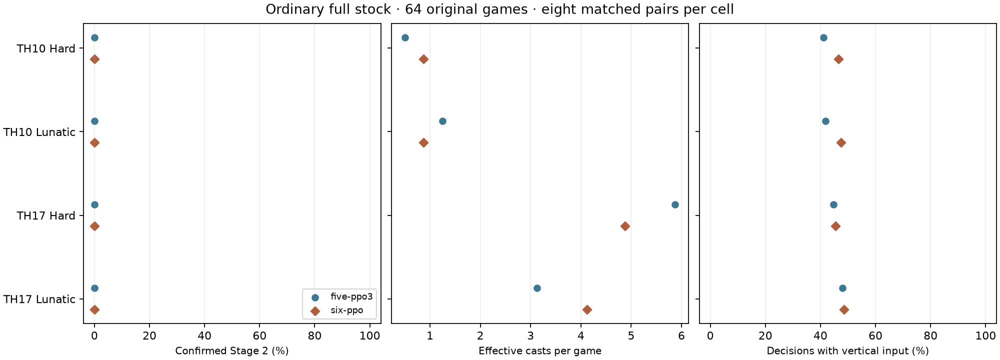

# Paired full-stock original-game results

Every title and difficulty supplied eight matched seeds for five-ppo3 and six-ppo. The full evaluation contains 64 ordinary original-game starts. Both arms use the same build and host within each pair. In-game randomness is uncontrolled.

| Original game | Stage 2, reference → candidate | Mean spare lives at end | Mean Bombs or Power at end | Confirmed casts, reference → candidate |
|---|---:|---:|---:|---:|
| TH10 Hard | 0/8 → 0/8 | 0.00 → 0.00 | Power 0.188 → 0.281 | 4 → 7 |
| TH10 Lunatic | 0/8 → 0/8 | 0.00 → 0.00 | Power 0.406 → 0.312 | 10 → 7 |
| TH17 Hard | 0/8 → 0/8 | 0.00 → 0.00 | Last playable Bombs 1.625 → 1.125 | 47 → 39 |
| TH17 Lunatic | 0/8 → 0/8 | 0.00 → 0.00 | Last playable Bombs 2.375 → 1.250 | 25 → 33 |

[Full-stock records](credits.json) · [Input and resource counts](whole-game-controls.json) · [Paired results by difficulty](paired-by-difficulty.json) · [Full Hard recording](https://github.com/Moonbow1969/touhou-training/releases/download/camera-training-2026-11-26/six-game-retention-first-hard-native-credits.mp4) · [Full Lunatic recording](https://github.com/Moonbow1969/touhou-training/releases/download/camera-training-2026-11-26/six-game-retention-first-lunatic-native-credits.mp4)

