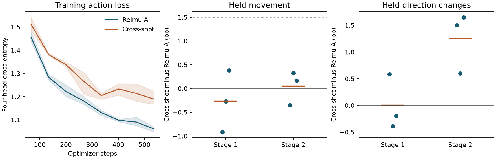

# Cross-shot human behavior cloning on the original TH07 0.11 Normal trial

Mixing other shot types into a fixed training budget did not meet the preregistered movement gate on zylo's Stage 1. Movement accuracy changed from **63.788% to 63.521%**. The three seed differences were **−0.917, −0.267 and +0.382 percentage points**. The required gain was +1.5 percentage points with at least two improving seeds. The learned locator stayed accurate at 5.657 native pixels in both arms.

| Diagnostic | Reimu A, Stage 1 | Mixed, Stage 1 | Reimu A, Stage 2 | Mixed, Stage 2 |
|---|---:|---:|---:|---:|
| Expert movement accuracy | 63.788% | 63.521% | 61.648% | 61.693% |
| Direction-change accuracy | 20.874% | 20.874% | 27.127% | 28.378% |
| Stable-direction accuracy | 74.201% | 73.868% | 69.311% | 69.089% |
| Movement negative log likelihood | 1.1231 | 1.1169 | 1.1367 | 1.1248 |
| Focus accuracy | 95.950% | 95.415% | 92.535% | 92.471% |
| Fire accuracy | 98.497% | 98.764% | 98.354% | 98.600% |
| Median localization, native px | 5.657 | 5.657 | 5.719 | 5.935 |

The numbers average the three training seeds. Stage 1 contains 2,617 held windows with 511 direction changes. Stage 2 is secondary and contains 3,666 windows with 666 direction changes. The mixed arm predicted the recorded movement with lower negative log likelihood in both stages. The Stage 2 switch difference was +1.251 points. Neither arm predicted either of the two Stage 2 Bomb onsets by argmax. Stage 1 contained no positive Bomb labels. Zylo is a single held player who was previously scored. Full-credit game performance was not evaluated in this ablation.

Each of six fits began from the same pretrained four-head visual actor, with the same zero-initialized learned shot embedding, XY auxiliary loss and Adam learning rate of 0.00003. Each ran 536 updates of 32 examples, with 16 from each stage at every update. The reference saw Boredperson's Reimu A exclusively. The mixed arm shared half of the exact minibatch and substituted four other-shot windows per new author per stage. Pykrete provided Reimu B and Marisa A, and XionGaTaosenai provided Sakuya A. The substitution changes shot and player diversity together. Each training source's chronological last 20% was reserved as a sanity check, and overlapping input/target windows at the boundary were purged. The two zylo stages were scored after all six final weights had been frozen. The exported native actor fixes Reimu A and accepts only camera pixels. Its four action heads, inherited critic and locator match the trained model's CPU outputs in multi-batch checks. The critic received no supervised objective.

The public archive includes the six conditioned states, six pixel-only exports, exact minibatches, all eight 67-step training blocks per fit, per-stage and per-seed evaluation, figures and source. The raw camera observations and author grouping are documented in the sibling human-author expansion. The prior native six-pair locator study addresses a different question.

[Download reproducible experiment](https://github.com/Moonbow1969/touhou-training/releases/download/camera-training-2026-11-26/th07-011-cross-shot-matched-six-policies.zip) · [Release checksum](release.json) · [Frozen protocol](protocol.json) · [Detailed scores](fit/result.json) · [Training log](training-log.txt)
