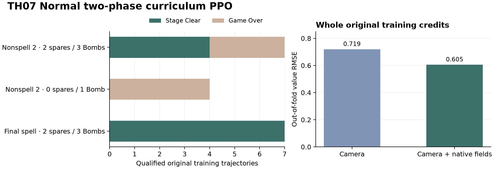

# TH07 Normal Nonspell 2 through final spell PPO

The original two-phase screen confirmed five completions and three Game Overs in eight fresh starts. In response it released the thirty-credit curriculum with twenty-one starting at Nonspell 2 and nine starting at the adjacent final spell. Eighteen credits passed technical admission. They yielded 7,139 decisions from Nonspell 2 and 3,644 from the final spell, with eleven confirmed objective completions in these admitted trajectories. [Frozen allocation](../nonspell-2-conditional-fit.json) · [Eight original screening games](../../th07-letty-nonspell2-train) · [Adjacent final-spell starts and replay evidence](../../th07-letty-final-spell-train)

| Admitted origin | Original Stage Clear | Original Game Over |
|---|---:|---:|
| Nonspell 2, 2 spares / 3 Bombs | 4 | 3 |
| Nonspell 2, 0 spares / 1 Bomb | 0 | 4 |
| Final spell, 2 spares / 3 Bombs | 7 | 0 |

The camera-only actor was initialized from the same frozen four-head policy that collected all eligible decisions. The RTX 4070 took 226 accepted Adam steps in two PPO epochs. Joint KL was 0.00151 after epoch one and 0.00135 after epoch two. Mean Bomb probability on the optimizer images moved from 1.927% to 1.969%. Whole-credit out-of-fold value RMSE was 0.719 with cameras and 0.605 with additional native clock, practice start and resource observations. The deployed actor receives the 96 × 112 grayscale image and preceding-frame difference alone. [Exact training log](learner.log) · [Fitter metrics](report.json) · [Credit and critic audit](protocol.json)

The frozen trained policy SHA-256 is `85ddfd821fca72c9c7c4f5c169ee19f52f4e4714fa811b29a08d518599640a67`. The independent seeded comparison tests twenty paired original Nonspell 2 starts with the same two spare lives, three Bombs, maximum power and 10,000 native tick cap on both arms. Its original Stage Clear comparison and the subsequent ordinary Game Start milestone use separate cohorts. [TorchScript checkpoint](policy.ts) · [Immutable optimizer input manifest](manifest.json)

The acquisition indexes include the two original scenario screens, the extension and its final-spell corroborating original. The optimizer manifest preserves paths relative to its actual run directory. Recreate the traces with `scripts/th07_retail_fragment_intake.py` from the original source archives and use the manifest hashes with `scripts/train_th07_curriculum_ppo.py`. [Nonspell 2 screen](letty-nonspell2-intake.json) · [Nonspell 2 extension](letty-nonspell2-extension-intake.json) · [Final-spell screen](letty-final-intake.json) · [Final-spell extension](letty-final-extension-intake.json)
