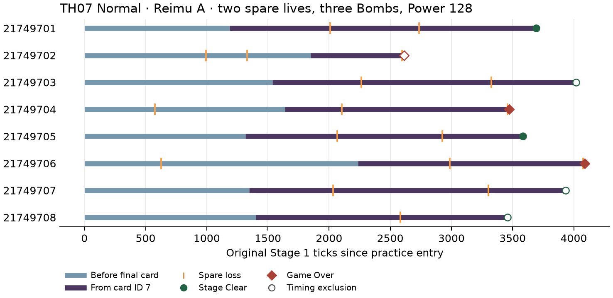

# Normal Letty, from Boss Nonspell 2

The same six-game camera policy began eight more original retail TH07 1.00b games one attack earlier. Every run used Normal Reimu A, Power 128, two spare lives, three Bombs and zero continues. The menu and independent native clock confirmed entry into the selected nonspell. During normal play its callbacks led into card ID 7. The registered limit was 10,000 elapsed native ticks, counting both phases and the original post-fight dialogue.

**5/8 runs reached the original Stage Clear tally. 4/8 met the strict input timing criterion.** The physical table retains every outcome and final stock. Across the eight original games the policy took 7,206 actions and lost 18 lives. Earlier practice at the last card alone yielded eight clears in eight attempts on this same parent policy. These controller seeds define a training feasibility screen. Ordinary Game Start Stage 2 remains a separate endpoint.

The chart uses the source game's own clock. Lines change color at the verified start of the final card. Hollow endpoints designate timing exclusions. The spell-phase observer has a 160-second diagnostics budget. The independent game clock, recording ring and captured terminal are recorded by the actor through its endpoint.

[Per-credit stocks](physical-stocks.csv) · [Independent control checks](independent-intake.json) · [Registration](registration.json) · [Signed original recordings](published-sources.json)
