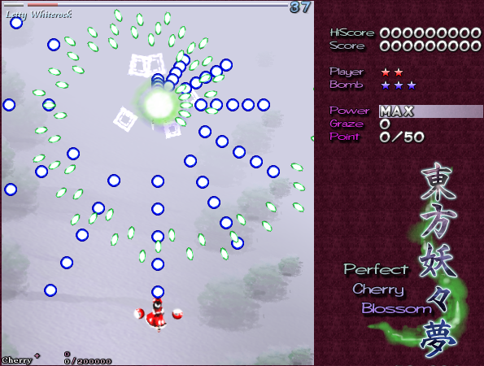

# TH07 retail practice starts

The official thprac 2.3.1.1 started two specific sections of the original TH07 1.00b on a private Gamer Wine/Xvfb display. Original gameplay and two independently read native clock fields confirmed each placement. These engineering runs collect no policy training or game-clear statistics.

| Requested section on Normal Reimu A | First observed spares / Bombs | Native stage | Native ticks (120 observations) |
| --- | ---: | ---: | ---: |
| [Stage 2 opening, practice defaults](stage2-default/proof.json) | 8 / 8 | 2 | 33–152 |
| [Stage 1 Letty, Boss Nonspell 1](letty-2-3/proof.json) | 2 / 3 | 1 | 41–160 |
| [Fresh automated Stage 2 opening](stage2-2-3/qualification.json) | 2 / 3 | 2 | 27–146 |

The fresh automated qualification took 52.16 seconds from container start through native verification. It confirmed the Stage 2, Warp None, two-life and three-Bomb menu glyphs with pixel overlap 1.00 before entering the game. The original game drew its Stage 2 banner. The Letty screen independently shows her name, boss timer and active bullets. Native measurements recorded Normal, Reimu A, no miss and zero continues throughout all three short samples. The displayed Power was MAX, matching the tool’s default of 128. This is an explicitly configured practice state.



The runner starts an existing project Wine image in its own network-disabled Docker container, creates a fresh in-memory game directory and Wine prefix, then binds the verified practice tool to the dedicated game process. Only the user-provided retail executable, data and the official tool enter through individually read-only mounts. Each directory records the original file list, before/after hashes, numerical trace, configuration screen and result. All game input is scoped to a private X display.

Build the supplied read-only validation probe on the Linux host with an existing C compiler. Supply the paths to the user-owned original installation and the official tool. The Python driver needs NumPy/Pillow; the existing image must include Wine32, Xvfb, xdotool, scrot and a working sound server. The standalone command closes and removes its private container after verification. When launching from Windows, add the optional `--wsl DISTRO` for the existing Linux Docker host.

```sh
cd tools/rollout-worker-probe/th07-retail100b/practice
cc -O2 -static probe.c -o /tmp/th07-practice-stageprobe
python qualify-stage2.py --game-dir /path/to/local/TH07 --thprac /path/to/thprac.v2.3.1.1.exe --probe /tmp/th07-practice-stageprobe --image existing-wine-image --out /path/to/new-run
```

The loader validates retail EXE `35467eaf8dc7fc85f024f16fb2037255f151cefda33cf4867bc9122aaa2e80ca`, data `5fe8d772191505bf208f966da8070ee0a9e0d0ee8567a8827ef3a362bcb0c287`, and thprac `42536217464b3b9ddf27ce9d8f13f07c0a09d510831ead24d19d0882825f7315`. Get the tool from its [official release](https://github.com/touhouworldcup/thprac/releases/tag/v2.3.1.1).

Two more independent cold starts at Normal Reimu A reached Letty with 0 spare lives and 1 Bomb, and Cirno’s midboss nonspell with 2 spare lives and 3 Bombs. Both yielded 120 consecutive native ticks, 1–120. Each read the original recording cursor and two game input slots twice per sample. The original screens identify the selected bosses. [Letty 0/1 trace](letty-0-1/native.csv) · [Cirno 2/3 trace](midboss-2-3/native.csv) · [Cirno original image](midboss-2-3/original-stage-crop.png).

The general reset arms a caller’s policy worker before it releases held keys and starts the selected section. The retail script routes a completed practice stage to its result screen. [Original routine](https://github.com/N0zoM1z0/th07/blob/2694946d17ea0fd1c219ffc255292ef9b79c4ade/src/Gui.cpp#L1026-L1045) · [Official practice section definitions](https://github.com/touhouworldcup/thprac/blob/18b8f4968591d2c90f4dffcb57c0ad6d306ee59b/thprac/src/thprac_games_def.json#L1886-L1924).

Compile the read-only observer and pass its path to the general reset. A learned controller can supply its native executable with `--actor` and its callback command after `--worker`. Windows can specify `--wsl DISTRO`.

```sh
cc -O2 -static probe-keys.c -o /tmp/th07-practice-probe
python practice_reset.py --game-dir /path/to/local/TH07 --thprac /path/to/thprac.v2.3.1.1.exe --probe /tmp/th07-practice-probe --image existing-wine-image --scenario letty-0-1 --out /path/to/new-run
```
