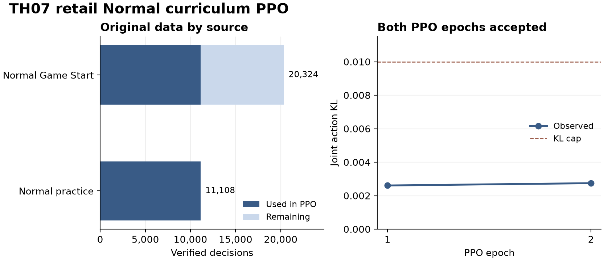

# TH07 retail Normal curriculum PPO

The quiet four-credit Easy comparison reached Letty four times, lost 12 lives in 31,572 Stage 1 ticks and reached Stage 2 zero times. Its 3.801 deaths per 10,000 ticks exceeded the prospective 2.364 release threshold. The registered Normal mixture supplied regular Stage 1 openings and later original states from full-stock Letty, low-stock Letty and Cirno. [Easy comparison](../th07-retail-easy-quiet-qualification) · [Initial protocol](protocol.json) · [Normal-practice registration and terminal amendment](normal-practice-release.json)

| Original training source | Physical starts | Qualified | Eligible decisions | Sampled for PPO |
|---|---:|---:|---:|---:|
| Normal Game Start, Endeavor and Accelerator | 17 | 16 | 20,324 | 11,108 |
| Normal practice, two separate Gamer lanes | 20 | 13 | 11,108 | 11,108 |

The Normal arm supplied 16 true Game Overs and one separately preserved original process stall. The practice arm supplied 18 true Game Overs and two playable 6,000-tick boundaries. Thirteen practice traces qualified, including one playable boundary with its genuine next camera. Seven practice traces failed exact timing at nine physical windows. Across all 20 practice starts, the original consumed every one of the 18,303 sampled requests. The four-tick match was 18,287 of 18,296 comparable complete windows. The practice dataset contains zero confirmed section clears. [Normal raw sources and engineering](../th07-retail-common-normal-train) · [Practice raw archives](fit/practice-raw-release.json) · [Independent intake](fit/independent-intake-summary.json)

The local RTX 4070 completed two PPO epochs and 464 accepted Adam updates. The same sampled action had its four logged probabilities recomputed for every admitted pre-update observation. Mean joint action KL was 0.00261 and 0.00275 after the respective epochs. Mean Bomb probability on the sampled training cameras moved from 1.628% to 1.494%. Across 28 whole training credits held out of their respective critic fits, value RMSE was 0.693 with image features and 0.061 with the additional native clock, scene and inventory features. The learned GAE bootstrap for the accepted playable cutoff was −0.837. The exported actor receives the camera pair alone. [Optimizer log](fit/learner.log) · [Value and sample protocol](fit/protocol.json) · [Fit report](fit/report.json) · [TorchScript checkpoint](fit/policy.ts)

Candidate SHA-256 `89fe8aabeeb604ea1c0e948f3456c006ecfe4afa49964b452e115bcd2e06853b`. The held comparison uses twenty independent paired frozen-policy allocations on the original full-stock Letty section. The ordinary Game Start test uses a separate range of seeds reserved by the protocol.

The exact optimizer manifest records paths relative to its original run folder. To reproduce from the published original archives, place each normalized trace and its corresponding receipt at its manifest path, or rebase both fields to a local copy and keep the source file hashes. `scripts/th07_retail_fragment_intake.py` recreates the normalized source from the full original trace, native journal and a matching behavior checkpoint. Use `scripts/train_th07_curriculum_ppo.py --manifest ... --parent ... --out ...` from the repository root. [Original optimizer manifest](fit/manifest.json) · [Game Start intake ledger](fit/cold-normal-intake.json) · [Practice intake ledger](fit/practice-intake.json)
