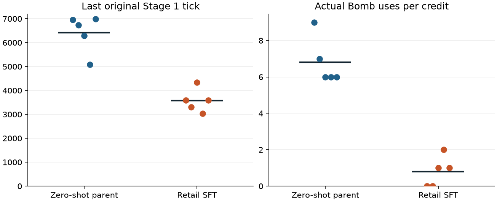

# Retail Normal SFT in ordinary original Game Start

The retail SFT failed its original-game promotion criterion. Five valid original credits per policy ended during Stage 1. The SFT reached 3,568.4 native ticks on average versus 6,410.0 for its zero-shot parent. The reserved technical credits ran out before the SFT accrued its prespecified 30,000 ticks, so the measurements below describe the observed subset.

| Original full-credit metric | Zero-shot parent | Retail SFT 71281 |
|---|---:|---:|
| Stage 2 reached | 0/5 | 0/5 |
| Stage 1 native ticks, total | 32,050 | 17,842 |
| Deaths per 10,000 Stage 1 ticks | 4.680 | 8.407 |
| Original score, mean | 687,426 | 259,730 |
| Terminal spare lives, mean | 0 | 0 |
| Terminal Bomb stock, mean | 1.2 | 3.0 |
| Confirmed Bomb uses | 34 | 4 |
| Deaths with positive Bomb stock | 4/15 | 15/15 |

The SFT-to-parent death rate ratio was 1.796. Both policies acted on every valid original window with zero stale masks. Minimum exact four-tick coverage among admitted credits was 99.528% for the parent and 100% for SFT. Each began with two spare lives and three Bombs. All settled admitted scorecards reported zero continues. The matching controller seed and physical machine do not synchronize the game’s internal RNG.

## Original evidence and technical exclusions

All six initial pairs and their two registered technical replacement pairs were attempted. Three pairs failed qualification. One SFT game reached the original Continue screen but loss of its ephemeral container during a collector recovery prevented official replay saving (2170751). Two parent credits had insufficient strict four-tick coverage (2170752 and 2170771). Their genuine terminal, native buffer and timing records remain available. No score-based replacement was made. The planned exposure-only extensions required six valid pairs and were never started.

The timing audit found that 15 targeted native ticks in 2170771-parent advanced again within 1.59–1.75 ms of observation. The original engineering adapter waited 1.5 ms before freezing. Every corresponding preceding four-tick window contained the correct requested mask. The frozen comparator also penalizes the resulting missing slot. Its unchanged verdict is retained in every table. Separately, one qualifying parent credit with complete exact controls experienced 924 CPU-throttled scheduling periods among 1,047 sampled periods. Throttling alone does not predict the observed failures.

| Seed | Qualified pair | Parent Stage 1 ticks | SFT Stage 1 ticks | Raw originals |
|---:|---|---:|---:|---|
| 2170751 | No | 4,046 | unsealed | [Complete archive](https://github.com/Moonbow1969/touhou-training/releases/download/camera-training-2026-11-26/th07-retail-native-pairs-pair-2170751.zip) |
| 2170752 | No | 6,683 | 3,477 | [Complete archive](https://github.com/Moonbow1969/touhou-training/releases/download/camera-training-2026-11-26/th07-retail-native-pairs-pair-2170752.zip) |
| 2170753 | Yes | 6,952 | 3,585 | [Complete archive](https://github.com/Moonbow1969/touhou-training/releases/download/camera-training-2026-11-26/th07-retail-native-pairs-pair-2170753.zip) |
| 2170754 | Yes | 6,732 | 3,304 | [Complete archive](https://github.com/Moonbow1969/touhou-training/releases/download/camera-training-2026-11-26/th07-retail-native-pairs-pair-2170754.zip) |
| 2170755 | Yes | 6,284 | 4,338 | [Complete archive](https://github.com/Moonbow1969/touhou-training/releases/download/camera-training-2026-11-26/th07-retail-native-pairs-pair-2170755.zip) |
| 2170756 | Yes | 5,090 | 3,030 | [Complete archive](https://github.com/Moonbow1969/touhou-training/releases/download/camera-training-2026-11-26/th07-retail-native-pairs-pair-2170756.zip) |
| 2170771 | No | 4,142 | 3,964 | [Complete archive](https://github.com/Moonbow1969/touhou-training/releases/download/camera-training-2026-11-26/th07-retail-native-pairs-pair-2170771.zip) |
| 2170772 | Yes | 6,992 | 3,585 | [Complete archive](https://github.com/Moonbow1969/touhou-training/releases/download/camera-training-2026-11-26/th07-retail-native-pairs-pair-2170772.zip) |

The film uses the first seed in registered order for which both raw original credits qualified (2170753). Its two columns show the actual policy cameras at measured 1× wall time. Shorter play holds its original scorecard while the other clock continues. [Watch both full credits](https://github.com/Moonbow1969/touhou-training/releases/download/camera-training-2026-11-26/th07-retail-original-pair-2170753.mp4)
