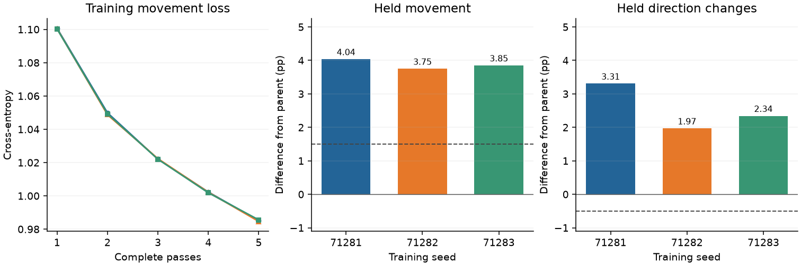

# Five-pass retail TH07 visual SFT

All three final models passed the registered aggregate offline criterion. Each ran 2,500 Adam updates on the same 16,000 distinct four-tick windows from four training players. Each of the five complete passes used every window once with equal player and stage representation in every batch. Two other players supplied 8,000 held windows.

| Frozen model | Movement accuracy | Changed-direction accuracy | Median player error (original px) |
|---|---:|---:|---:|
| parent | 54.32% | 20.38% | 13.91 |
| 71281 | 58.36% | 23.69% | 5.95 |
| 71282 | 58.08% | 22.35% | 5.97 |
| 71283 | 58.17% | 22.73% | 6.02 |

Mean over the three seeds: movement +3.88 percentage points, changed directions +2.54 points, median position error 5.98 native pixels. The three registered thresholds were +1.50 points, −0.50 points and 12 native pixels, respectively.

| Held player | Zero-shot movement | Fitted movement | Zero-shot switches | Fitted switches |
|---|---:|---:|---:|---:|
| シャオ | 54.62% | 58.02% | 20.02% | 21.80% |
| ZEX | 54.03% | 58.38% | 20.75% | 24.05% |

The held bank contains only one Bomb onset. Neither the parent nor any fitted model chose Bomb by argmax on that row. There are two independent held authors, and all examples come from their first two stages. This comparison measures behavior cloning and visual localization. Game Start survival, resource use and ending require prospective original-game testing.

The public files include all final TorchScript weights, per-epoch loss and minibatch-order digests, the frozen study and source hashes, four head metrics, per-player and per-stage results, and a SHA-bound data loader.

