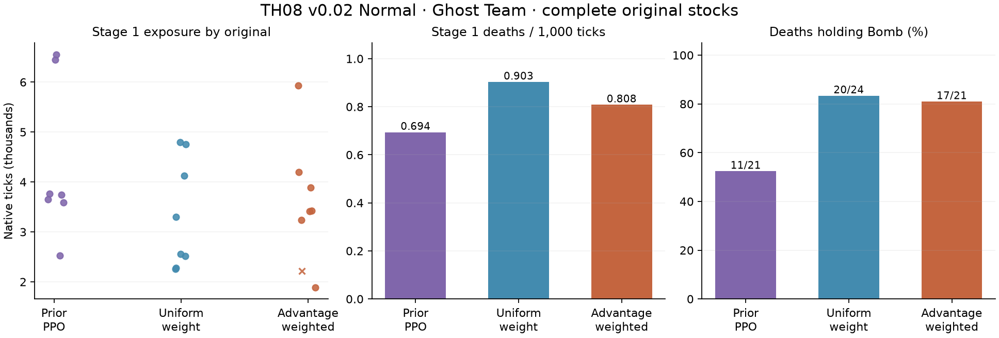

# TH08 Normal original comparison with advantage-weighted imitation

The original Stage 1 death-rate ratio for advantage weighting versus uniform weighting was **0.895** (descriptive 95% resampling interval 0.666–1.200). Versus the prior PPO the ratio was **1.165** (0.840–1.583). The registered promotion gate did not pass. Gate interpretation also requires sufficient exposure in all three arms, recorded as **True**.

| Policy | Physical / qualified | Stage 1 deaths / native ticks | Deaths holding Bomb | Stage 2 / known | Mean final spares / Bomb | Same-life Bomb units spent (qualified) |
|---|---:|---:|---:|---:|---:|---:|
| Prior PPO | 7 / 7 | 21 / 30,270 | 11 / 21 | 0 / 7 | 0.00 / 1.57 | 39 |
| Uniform weight | 8 / 8 | 24 / 26,581 | 20 / 24 | 0 / 8 | 0.00 / 2.00 | 27 |
| Advantage weighted | 8 / 7 | 21 / 25,987 | 17 / 21 | 0 / 8 | 0.00 / 2.00 | 29 |

Every run used the official TH08 0.02 trial, Ghost Team on Normal, two starting spare lives and three Bombs. The four independently sampled heads controlled movement, focus, firing and Bomb. An independent observer checked the original consumed key word and Stage 1 clock. Each physical original began from the normal story menu and ended at the genuine Game Over or clear without a continue. The two Accelerator lanes ran the continuous four-native-tick operator. Exact controller seeds were unique across arms. The small intervals independently resample whole credits within lane and arm and describe this exposure-stopped sample. A cross marks any technically withheld credit with measured exposure on the left panel.

[Recorded camera comparison](https://github.com/Moonbow1969/touhou-training/releases/download/camera-training-2026-11-26/th08-awr-original-held-3policy-recorded-camera.mp4) uses the first credit of each policy on the same physical lane, selected before outcomes, with the actual recorded policy cameras and original timestamps. The playfield was sampled every four native ticks and the excerpts rendered at 15 fps. Each sampled action, ending photograph, score and downloadable complete native source is linked in the tables.

[Complete per-credit table](physical-credits.csv) · [Recorded native sources and checksums](published-sources.json) · [Preregistered exposure rule](exposure-amendment.json) · [Machine-readable results](native-results.json)

Run `python scripts/summarize_th08_awr_originals.py results/2026-11-26-original-camera-training/th08-camera-awr-native` from the repository root to independently recalculate both ratios and bootstrap intervals from the signed public records. Use `scripts/render_th08_awr_originals.py` with the downloaded recorded cameras to render the same three-arm excerpts.
