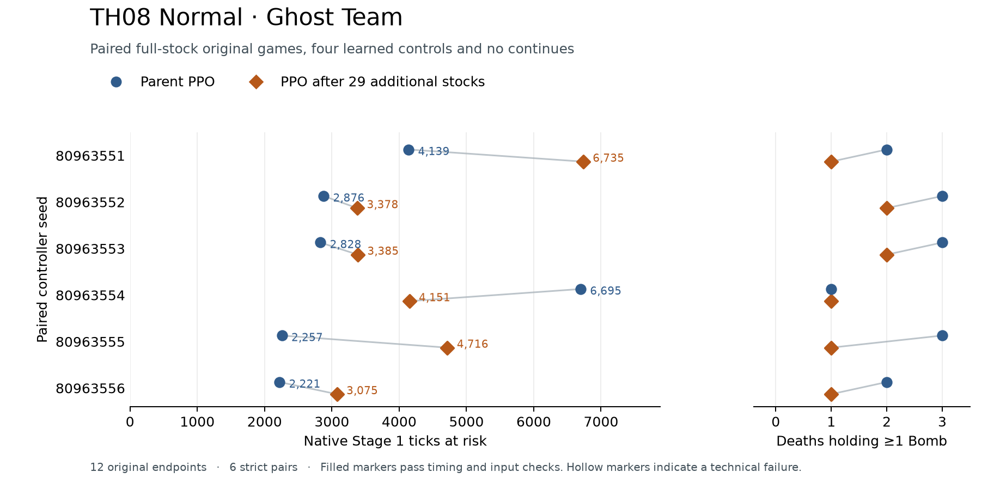

# TH08 original Normal Ghost, second on-policy update

The original 0.02 trial started each credit with two spare lives and three Bombs. The game received four learned action heads. Each paired seed ran on the same physical lane. Original game RNG was uncontrolled.

| Actor | Completed | Strict controls | Reached Stage 2 | Confirmed Stage 1 | Stage unknown | Mean terminal spares | Mean terminal Bombs |
|---|---:|---:|---:|---:|---:|---:|---:|
| lambda1-parent | 6 | 6 | 0 | 6 | 0 | 0 | 1.167 |
| lambda1-continuation | 6 | 6 | 0 | 6 | 0 | 0 | 0.667 |

| Paired measure | Matched seeds | Stage 1 lost lives, parent / continuation | Native exposure ticks, parent / continuation | Death rate ratio | 95% paired bootstrap interval |
|---|---:|---:|---:|---:|---:|
| Physical outcomes | 6 | 18 / 18 | 21016 / 25440 | 0.8261 | 0.5991, 1.1696 |
| Strict control | 6 | 18 / 18 | 21016 / 25440 | 0.8261 | 0.5991, 1.1696 |

Predeclared decision: `stop_current_scale`. Promotion requires both a strict paired Stage 1 death rate ratio ≤0.75 and a continuation share of deaths holding Bomb ≤60%.

The original records include every pre-action grayscale observation, compact RGB frames, full-size terminal and menu photographs, the original stage-indexed input buffer, native clock, and the sampled action, log probability and critic. Neither arm recorded a full-screen movie.

[Registered host, seed and order](held-registration.json) · [Hash-verified original records and decisions](published-sources.json) · [Independent original score check](independent-original-check.json) · [Three excluded previous training outcomes](parent-training-excluded-physical-outcomes.json)

To reproduce the native result, download the original archive for each arm and seed from the release links and confirm its listed SHA256. Extract each into `<study>/<arm>/raw/<seed>/` beside these small reports. Run `python -m scripts.verify_th08_async_held_originals <study>` from the repository root. The verifier reconstructs control requests and stale intervals from the raw game-consumed words, reads the result screen and stage clock, and recomputes deaths and Bomb reserves from the original HUD history.
