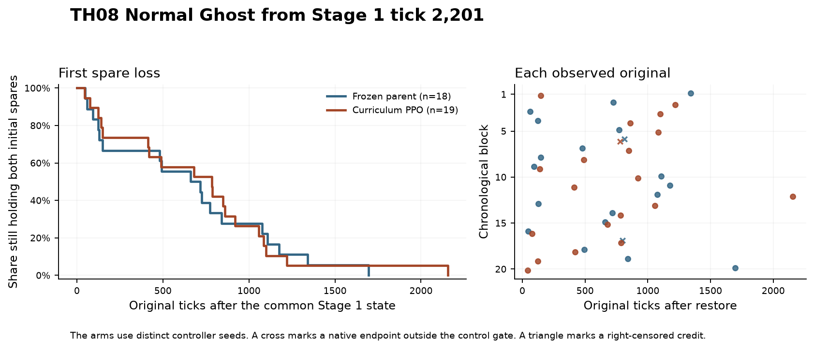

# TH08 Normal Ghost held evaluation from a fixed Stage 1 state

Curriculum PPO had **0.924× the frozen parent's first-spare-loss rate** per native tick from this state (95% descriptive bootstrap interval 0.562–1.483). The point estimate fell between the stopping and ordinary Game Start promotion thresholds. The ordinary-opening promotion threshold was a loss rate ratio of at most 0.75. A ratio of at least 1.00 stopped this intervention.

Both actors started at original Stage 1 tick 2,201 with two spare lives and one Bomb. The exact native state came from TH08's official 0.02 Normal Ghost trial in a KVM guest. Every continuation ended on the first observed reserve loss or after 3,000 additional ticks. The arms used 40 distinct controller seeds across 20 chronological blocks. Each arm went first in ten blocks. The endpoint data therefore describe independent stochastic continuations of one state.

| Frozen policy | Qualified releases | First spare losses | Right-censored | Original ticks at risk | Losses / 1,000 ticks | KM median ticks | Confirmed Bomb units spent on the same life | Losses holding Bomb |
| --- | ---: | ---: | ---: | ---: | ---: | ---: | ---: | ---: |
| Frozen parent | 18 | 18 | 0 | 11,680 | 1.541 | 660 | 12 | 6/18 |
| Curriculum PPO | 19 | 19 | 0 | 13,348 | 1.423 | 784 | 14 | 5/19 |

The two-sided log-rank test gave *p* = 0.8409. The interval resamples entire held fragments independently within each arm using 20,000 bootstrap draws. 40 of 40 physical attempts had a verified native endpoint. Of those, 37 passed the frozen control gate. Including every observed physical endpoint gave a loss rate ratio of 0.941. Dispositions and reason codes for every controller seed are retained.



The earliest registered chronological block is also available as a 15 fps side-by-side recording of the actual 96×112 policy cameras. The observed key, native Stage 1 tick and inventories accompany each frame. Each arm holds its final observed image once its outcome occurs. [Download the first original camera comparison](https://github.com/Moonbow1969/touhou-training/releases/download/camera-training-2026-11-26/th08-one-anchor-ppo-first-held-block-cameras.mp4) · [Clip and source SHA-256](first-held-block.json)

The policy received grayscale frames and sampled direction, focus, fire and Bomb. Native words from the original game validate the physical keys consumed. Stock comes from a registered original HUD crop. Bomb spending counts stock decreases on the same life. The observed Bomb reserve immediately before a loss is retained separately. The measurement interval intentionally ends at the registered loss or time cap, so this study does not estimate full-game clearance. [Per-seed original outcomes](original-outcomes.json) · [Numerical survival report](results.json) · [PPO weights and training report](../policy) · [Training sources](../anchor-train)

The frozen pre-update allocation and its SHA-bound deployment roster, independent verifier, and native source downloads support a full recheck. Extract the release source blocks into this folder to reproduce per-credit auditing. All masks, raw camera differences, action log-probabilities and value are independently checked against the assigned TorchScript actor, while the original 531-action prefix remains bound to the parent. [Study allocation](schedule.json) · [Deployed checkpoint and seeds](registration.json) · [Downloadable original sources with SHA-256](published-sources.json) · [Measured guest and transfer timing](physical-timing.json)

The original game advanced at 60.05 native ticks/s during active play. The entire 40-start sequence took 26.14 minutes, giving 17.48 ticks/s including restore, source transfer and independent admission. The median restore was 9.28 seconds. The source archive retains each observed clock miss, the corresponding key words and the timestamps of the next camera and input. [Cadence outlier evidence](cadence-outliers.json)

Regenerate the quantitative report and picture using:

```sh
python auditor/score-held-originals.py original-outcomes.json results.json
python auditor/plot-held-survival.py original-outcomes.json results.json held-first-loss.png
```
