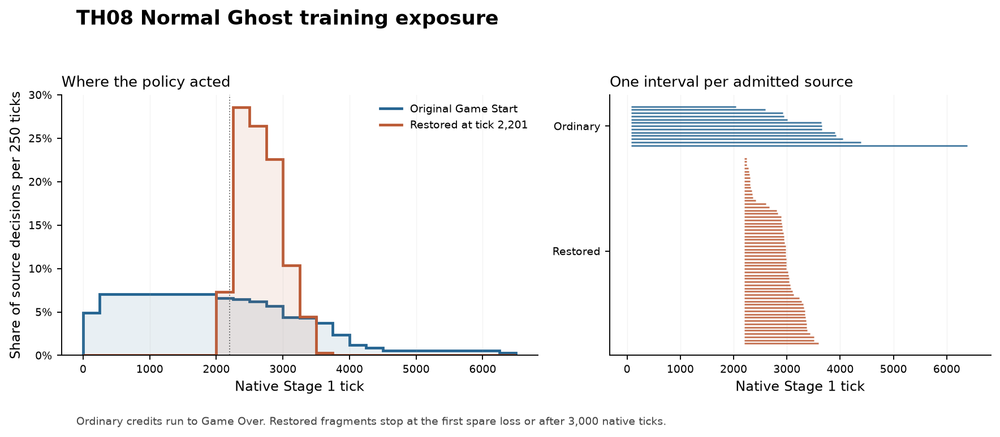

# TH08 Normal Ghost restored-state training sources

One licensed local copy of ZUN's official 0.02 trial provided the original game. All 60 continuations began in the same live Stage 1 state in a KVM guest. The original camera, clock, previous policy image, control word and resources were preserved at tick 2,201, after 531 learned actions, with two spare lives and one Bomb. Each continuation used a fresh registered controller seed, the frozen camera actor, and four sampled heads for direction, focus, fire and Bomb. The policy received two grayscale channels. The archive records original-game clocks and keys for independent verification.

The source ended at the first reserve loss or after 3,000 native ticks, whichever came first. Across all physically observed continuations the endpoints were 60 life loss cutoff. Elapsed original time ranged from 52 to 1,392 ticks, with a median of 784.0. Each playable cutoff preserved the next camera and signed critic bootstrap. There were zero continues.

| Original source | Physical starts | Admitted for PPO | Admitted Stage 1 decisions | Decisions at native tick ≥3,000 |
| --- | ---: | ---: | ---: | ---: |
| Game Start through Game Over | 16 | 13 | 11,540 | 2,410 |
| Same Stage 1 state through the registered cutoff | 60 | 58 | 10,278 | 1,550 |

Across the physical restored group the game consumed 10,708/10,708 requested actions and produced 10,704/10,708 exact four-tick windows. Across the admitted restored group the corresponding window count was 10,278/10,278. The technical exclusions were 80965430, 80965435. Every exclusion has a source archive and signed disposition. No replacement seeds were used. The two groups receive equal optimizer source weight. Both groups contain training data and have different endpoint rules. A separate frozen-policy evaluation is required to measure improvement.



The complete joint input is listed in the [optimizer manifest](../optimizer-manifest.json). The [registered controls](registration.json), [per-seed source receipts](receipts), [original source audit](source-intake.json) and [coverage behind the figure](source-native-exposure.json) record the evidence for admission. The five downloads include all original command words, native clocks, synchronous camera/input timestamps, stock and rank HUD crops, policy cameras, sampled actions and prespecified exclusions. Their individual file and release SHA-256 values are in the [download index](published-sources.json).

- Controller seeds 80965401–80965412 (46,259,647 bytes). [Original trace archive](https://github.com/Moonbow1969/touhou-training/releases/download/camera-training-2026-11-26/th08-one-anchor-ppo-physical-train-80965401-80965412.zip)
- Controller seeds 80965413–80965424 (39,652,366 bytes). [Original trace archive](https://github.com/Moonbow1969/touhou-training/releases/download/camera-training-2026-11-26/th08-one-anchor-ppo-physical-train-80965413-80965424.zip)
- Controller seeds 80965425–80965436 (37,395,375 bytes). [Original trace archive](https://github.com/Moonbow1969/touhou-training/releases/download/camera-training-2026-11-26/th08-one-anchor-ppo-physical-train-80965425-80965436.zip)
- Controller seeds 80965437–80965448 (43,352,973 bytes). [Original trace archive](https://github.com/Moonbow1969/touhou-training/releases/download/camera-training-2026-11-26/th08-one-anchor-ppo-physical-train-80965437-80965448.zip)
- Controller seeds 80965449–80965460 (46,126,736 bytes). [Original trace archive](https://github.com/Moonbow1969/touhou-training/releases/download/camera-training-2026-11-26/th08-one-anchor-ppo-physical-train-80965449-80965460.zip)

## Reproduce one restored credit

Extract the first release ZIP into this directory. With NumPy and CPU PyTorch installed, the following verifies the preserved first seed. The normal-rank glyph is a derived binary witness. The policy artifact is the exact actor used to collect these samples.

```sh
python auditor/verify-compact-fragment.py --registration registration.json \
  --prefix evidence/initial-anchor-behavior-prefix.npz \
  --normal-glyph auditor/normal-hud-glyph.npy \
  --model ../../th08-progress-lambda1-round2/policy/progress-plus-spares/policy.ts \
  --compact evidence/80965401-compact.tar.gz --fragment shards/80965401.npz \
  --seed 80965401 --out reproduced-80965401.json
```

The validator reconstructs the full original behavior shard using the shared prefix, checks its SHA-256, independently reads the live masks, tick intervals, stock and difficulty, and replays every action log-probability and value against the frozen actor. For the source coverage plot, extract the remaining restored archives here and the [ordinary training sources](../ordinary-train) under their original manifest paths, then run `python auditor/plot-training-coverage.py ../optimizer-manifest.json .`.
