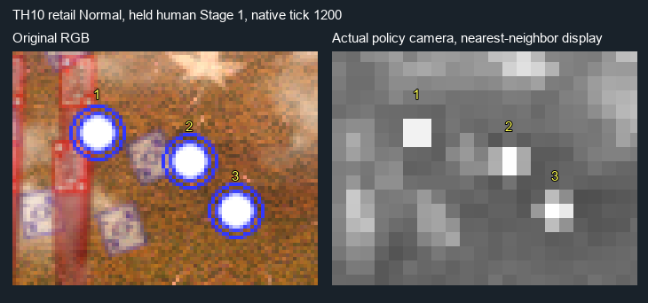

# Original TH10 Normal sensor and input diagnosis

Scope is Steam TH10 1.00a, Normal Reimu A, at the original game opening. The native observer is read-only and the pulse test used a separate credentialed disposable copy of the original game profile. Five eligible original credits supplied 48 balanced four-tick left or right pulses each. Initial setup attempts with no pulses appear outside the measurement population.

| Measurement | Result |
|---|---:|
| Key consumed one native tick after issue | 240/240 |
| First movement at the native consumption tick | 240/240 |
| Issue to first observed consumption, median and p95 | 16.66 ms and 17.43 ms |
| Image capture call, median and p95 | 1.85 ms and 2.06 ms |
| Captures bracketed within one original tick | 3,030/3,030 |
| Best lag for rendered player position versus native XY | +1 native tick in all five credits |

The sprite lag uses horizontal pulse motion and the red costume at the fixed opening Y coordinate. It estimates original screenshot alignment during the opening. It covers neither later boss patterns nor display photon latency.

Existing authentic replay evidence uses the exact captured original images and the underlying synchronized native key stream. Holding the first recorded direction at each boundary changes the following fraction of native ticks.

| Original human replay pool | 2 ticks | 4 ticks | 8 ticks |
|---|---:|---:|---:|
| Four Normal Reimu A training pilots, 33,856 input ticks | 2.99% | 8.45% | 17.55% |
| Twelve Normal training pilots, 117,552 input ticks | 3.00% | 8.50% | 17.44% |
| One separate Normal Reimu A held pilot, 18,528 input ticks | 3.34% | 9.39% | 19.69% |

At native tick 1,200, the original 640×480 image and the archived 96×112 input match exactly after the production crop and transform. Three selected blue-white bullets kept only four, two and one very bright pixels from white cores spanning eight original pixels in each dimension. The three remain visible in that frame. Denser sections and the visibility of threats near life loss require additional evidence.

[Pulse protocol](native-latency-protocol.json) · [Every latency measurement](native-latency.json) · [Per-pilot recorded inputs](human-recorded-control-bandwidth.json) · [Exact aligned pixel evidence](held-human-pixel-proof.json)

The held Reimu A player's two stages also isolate one-step action errors on the same recorded images and native inputs. An ideal four-tick hold using the human's first direction differs from the full human sequence on 9.36% of Stage 1 ticks. When the specialist chooses its most probable direction, that figure is 40.96%. With stochastic sampling, the expected mismatch is 51.45%. These errors measure imitation on recorded states and can include legitimate alternative movements. They establish the size of the action-selection problem alongside the cadence cost. [All three checkpoint comparisons](held-policy-vs-bandwidth.json)

A single CPU thread processed 300 predecoded original frames through the specialist's resize, difference, policy and Softmax in 10.69 ms median (11.61 ms p95). The benchmark excludes capture and input. [Processing profiles](post-capture-cpu-cost.json)
