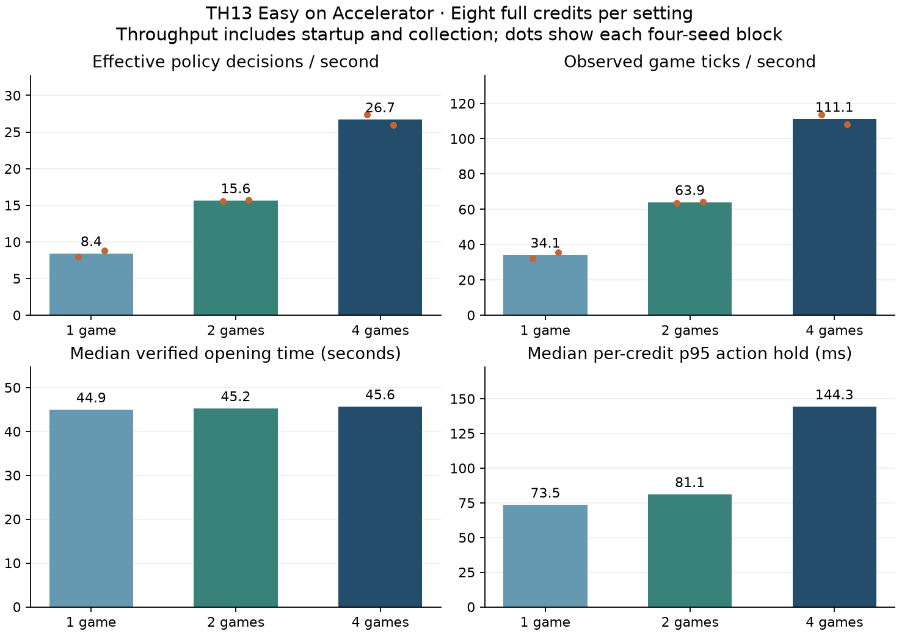

# Full-stock rollout capacity on Accelerator

TH13 Easy ran eight independent full-stock original credits at each concurrency, using the same eight controller seeds, frozen camera SFT and four-tick input rule. Every instance had a private game process and display. A complete block included cold start, physical original-game play and retrieving the final records. Four workers supplied 3.17 times the verified decisions per wall second of one worker and 1.71 times the throughput of two.

| Concurrent instances | Verified decisions/s | Native ticks/s | Credits/hour | Mean busy CPU cores | Median startup to stock (s) |
|---:|---:|---:|---:|---:|---:|
| 1 | 8.42 | 34.09 | 23.74 | 2.34 | 44.93 |
| 2 | 15.64 | 63.94 | 38.75 | 3.77 | 45.22 |
| 4 | 26.69 | 111.07 | 67.46 | 7.57 | 45.64 |

The original game acknowledged 10,219/10,219, 11,620/11,620 and 11,395/11,395 sampled decisions, respectively. Higher concurrency raised per-instance tail latency. The host retained 23.8 GiB of available memory at its minimum. Eight four-worker credits transferred 87.4 MB. Original game RNG can alter trajectory length across concurrency levels. [Full measurements and launch command](throughput.json) · [Host samples and storage](host-costs.json) · [Raw verified evidence](native-capacity-evidence.release.json)

